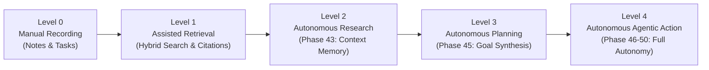

# PHASE 42 — AUTONOMY ROADMAP
## Foundations Laid for Phases 43–50 Autonomous Personal Intelligence

- **Project:** Personal Assistant PWA — Autonomous Personal Intelligence System
- **Current State:** Phase 42 Complete (Knowledge Intelligence Foundation)
- **Target Architecture:** Autonomous Cognitive Second Brain with L0–L4 Autonomy Progression

---

## 1. Autonomy Progression Framework

Phase 42 establishes the structural bridge between **Level 1 (Assisted Retrieval)** and **Level 2 (Autonomous Research)**.

---

## 2. Specific Technical Capabilities Unlocked by Phase 42

| Capability Unlocked | Phase 42 Prerequisite | Next Consumer Phase |
|---|---|---|
| **Semantic Long-Term Memory** | `KnowledgeChunk` vector representations & metadata | **Phase 43: Autonomous Research & Memory** |
| **Episodic Life Timeline Context** | Date-bound `isJournal` notes & reflection anchors | **Phase 44: Contextual Life Synthesis** |
| **Topological Entity Dependency** | `KnowledgeRelation` linking notes, projects & goals | **Phase 45: Autonomous Goal & Task Planning** |
| **Autonomous Action Triggering** | AI action-item extraction with estimated durations | **Phase 46: Automation Studio & Background Workers** |
| **Multimodal Voice Ingestion** | Markdown structured storage with revision rollback | **Phase 47: Conversational 3D Avatar Knowledge Ingestion** |
| **Agentic Self-Correction** | Immutable `KnowledgeVersion` snapshots & rollback | **Phase 48: Autonomous Agent Reliability & Self-Healing** |

---

## 3. Preparation for Phase 43: Autonomous Research & Contextual Memory

With the knowledge foundation operating stably with live Supabase PostgreSQL persistence:
1. **Context Vector Engine:** Build on `KnowledgeChunk` to support embedding generation via `@google/genai` or HuggingFace local models.
2. **Context Window Assembly:** Feed retrieved citations into the 3D voice avatar companion's short-term context memory.
3. **Autonomous Knowledge Ingestion:** Allow background workers to autonomously summarize daily habits, completed tasks, and financial records into journal notes.

