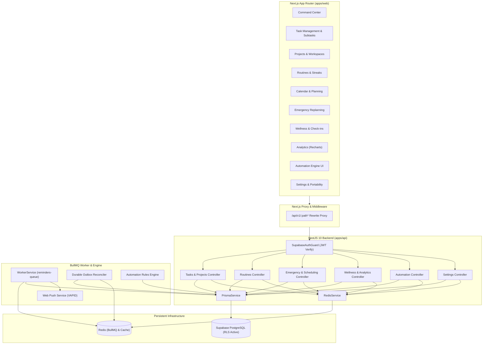

# Enterprise Personal Assistant PWA — Architecture Specification

**Project:** Personal Task, Routine, Smart Reminder & Wellness Assistant  
**Platform:** Desktop & Mobile Progressive Web App (PWA)  
**Author:** Senior Full-Stack & System Architect  
**Date:** October 2026  
**Status:** Implemented & Verified  

---

## 1. Executive Summary & Architectural Vision

The Personal Task, Routine, Smart Reminder & Wellness Assistant PWA is designed as a mission-critical personal operating system. It bridges high-velocity task management, long-term project milestones, deterministic recurring routines, proactive notifications, emergency schedule adjustments, self-reported wellness tracking, and automated productivity rules.

The system is built on an enterprise monorepo with strict architectural boundaries:
- **Presentation Layer (`apps/web`):** Next.js 14 App Router, React 18, TypeScript strict mode, Tailwind CSS, Framer Motion, and Recharts. All user interactions use custom, accessible UI primitives (no browser `prompt()`, `alert()`, or `confirm()`).
- **Application & API Layer (`apps/api`):** NestJS 10 modular REST API with global exception filters, response transformation interceptors, cryptographic JWT validation, and BullMQ background workers.
- **Data Persistence & Isolation (`Supabase PostgreSQL`):** 16 relational data models governed by foreign key constraints, cascading deletion rules, compound uniqueness, composite indexes, and PostgreSQL Row-Level Security (RLS) policies.
- **Queue & Event Layer (`Redis & BullMQ`):** Redis-backed job queues with durable transactional outbox recovery, quiet hours deferral, task-state revalidation, and retry policies.
- **Shared Contracts (`packages/shared`):** Single source of truth for DTOs, Enums, Zod validation schemas, and API contracts.



---

## 2. Shared Domain Contracts (`packages/shared`)

All models and API payloads share immutable TypeScript definitions and runtime Zod schemas.

### Core Enums
- **`TaskCategory`**: `WORK`, `PERSONAL`, `ROUTINE`, `WELLNESS`
- **`Priority`**: `LOW`, `MEDIUM`, `HIGH`, `URGENT`
- **`SchedulingMode`**: `FIXED_APPOINTMENT`, `FLEXIBLE`
- **`TaskStatus`**: `PENDING`, `IN_PROGRESS`, `COMPLETED`, `SKIPPED`, `RESCHEDULED`, `CANCELLED`
- **`RecurrenceFrequency`**: `DAILY`, `WEEKDAYS`, `WEEKENDS`, `WEEKLY`, `CUSTOM`
- **`ReminderStatus`**: `SCHEDULED`, `SENT`, `FAILED`, `CANCELLED`, `SNOOZED`
- **`ProjectStatus`**: `ACTIVE`, `COMPLETED`, `ARCHIVED`
- **`AutomationRuleType`**: `OVERDUE_ALERT`, `UPCOMING_REMINDER`, `BREAK_SUGGESTION`, `CONFLICT_AUTO_SUGGEST`
- **`WellnessMetricType`**: `WATER_ML`, `EXERCISE_MINUTES`, `SLEEP_HOURS`, `BREAK_COUNT`, `MEAL_COUNT`

---

## 3. Database Schema & Multi-Tenant Security

### Authoritative Relational Models (Prisma 5.22)
1. **`User` & `UserSettings`**: Anchor identity model with preferred work hours (`workStartHour`, `workEndHour`), quiet hours, default durations, and lead reminder intervals.
2. **`Project`**: Groups tasks with target completion dates, status, hex colors, and dynamic progress calculation.
3. **`Task`**: Hierarchical task model supporting parent/subtask self-relations (`parentTaskId`), project linkage (`projectId`), priority, estimated duration, scheduling mode, fixed start/end times, and notes.
4. **`TaskEvent`**: Immutable append-only audit trail logging `CREATED`, `UPDATED`, `COMPLETED`, `REOPENED`, `SNOOZED`, `RESCHEDULED`, and `STATUS_CHANGED`.
5. **`Routine` & `RoutineOccurrence`**: Habit definitions with recurrence frequencies, target quantities, and daily occurrence logs. Definition updates preserve historical occurrences.
6. **`SchedulePlan` & `ScheduleChange`**: Versioned daily plan snapshots (`planVersion`) tracking baseline versus re-planned schedules during emergency events.
7. **`Reminder` & `ReminderAttempt`**: Scheduled reminder instances linked to tasks, recording channel, trigger times, delivery status, latency, and error logs.
8. **`PushSubscription`**: Browser Web Push endpoints with P256DH and auth cryptographic keys.
9. **`WellnessMetric` & `WellnessCheckIn`**: Numeric physical logs (water, exercise, sleep) and subjective 1–5 scale mental state check-ins (energy, mood, stress, fatigue).
10. **`DailySummary`**: Materialized daily metrics (completion rates, streak counts, wellness summaries).
11. **`OutboxEvent`**: Transactional outbox guaranteeing delivery of background events even during Redis restarts.
12. **`AutomationRule` & `AutomationRuleExecution`**: Configurable rule conditions, actions, cooldown intervals, and audit logs.

### Multi-Tenant Isolation & Row-Level Security (RLS)
Every table features a mandatory `user_id` foreign key. Supabase PostgreSQL Row Level Security is enabled across all tables:
```sql
ALTER TABLE "projects" ENABLE ROW LEVEL SECURITY;
CREATE POLICY "Users can only access their own projects"
  ON "projects" FOR ALL
  USING (auth.uid() = user_id);

ALTER TABLE "automation_rules" ENABLE ROW LEVEL SECURITY;
CREATE POLICY "Users can only access their own automation rules"
  ON "automation_rules" FOR ALL
  USING (auth.uid() = user_id);

ALTER TABLE "automation_rule_executions" ENABLE ROW LEVEL SECURITY;
CREATE POLICY "Users can only access their own automation executions"
  ON "automation_rule_executions" FOR ALL
  USING (auth.uid() = user_id);
```

### Cryptographic Supabase Auth Guard
The backend validates incoming bearer tokens using standard cryptographic verification:
- **Verification:** Algorithmic HMAC-SHA256 signature verification against `SUPABASE_JWT_SECRET`.
- **Claims validation:** Audience (`authenticated`), Issuer (`https://<project-ref>.supabase.co/auth/v1`), and expiration timestamp (`exp`).
- **User lifecycle:** Automatically creates or synchronizes the internal `User` and `UserSettings` rows upon first authenticated request.
- **Zero Fallback in Production:** In production mode, unsigned or spoofed tokens fail immediately with `401 Unauthorized`.

---

## 4. Scheduling & Emergency Replanning Engine

The scheduling engine implements deterministic interval math:
- **Duration / End Time Auto-Recalculation:**
  - Modifying `estimatedDurationMinutes` updates `fixedEndTime = fixedStartTime + duration`.
  - Modifying `fixedEndTime` recalculates `estimatedDurationMinutes = (fixedEndTime - fixedStartTime)`.
  - Negative or zero durations are rejected.
- **Conflict Detection:** Identifies overlaps between fixed appointments and alerts the user in the Command Center.
- **Emergency Replanning Workflow:**
  1. Captures unexpected urgent task or event.
  2. Identifies all scheduled tasks for the target date.
  3. **Preserves Fixed Appointments:** Hard appointments (`SchedulingMode.FIXED_APPOINTMENT`) remain pinned to their fixed time slots.
  4. **Pushes Flexible Tasks:** Flexible tasks overlapping the emergency window are shifted sequentially into the next available work hour blocks.
  5. **Audit Logging:** Creates a new `SchedulePlan` with an incremented `planVersion` and logs each moved task into `ScheduleChange`.
  6. **Safe Cancellation:** Replanning can be safely previewed and cancelled without modifying active tasks until confirmed.

---

## 5. Background Processing & Notification Infrastructure

- **BullMQ & Redis Queue:** Reminders are scheduled into `reminders-queue` with precise delay offsets.
- **Task-State Revalidation:** Before dispatching push notifications, the worker re-queries the database. If a task was already completed, skipped, or cancelled, notification delivery is aborted (`ReminderStatus.CANCELLED`).
- **Quiet Hours Enforcement:** If a scheduled reminder falls within user-configured quiet hours, it is deferred to the end of quiet hours.
- **Durable Outbox Reconciler:** A background reconciler executes every 30 seconds to catch outbox events that were queued during Redis outages, ensuring zero lost notifications.
- **Standard Web Push:** Notifications are encrypted using ECDH curve P-256 and signed with VAPID keys before sending to user endpoints.

---

## 6. Automation Rules Engine

Deterministic rules enforce productivity best practices without nondeterministic model hallucinations:
- **`OVERDUE_ALERT`:** Identifies tasks past their scheduled time and creates notification events.
- **`UPCOMING_REMINDER`:** Proactively triggers reminders ahead of lead times.
- **`BREAK_SUGGESTION`:** Detects continuous work sessions exceeding 120 minutes without a logged break and suggests a pause.
- **`CONFLICT_AUTO_SUGGEST`:** Detects overlapping appointments and flags recommended adjustments.
- **Cooldown & Loop Protection:** Every rule defines a `cooldownMinutes` threshold. Rules cannot re-trigger until the cooldown expires, preventing notification loops.
- **Execution History:** Every trigger is permanently logged in `AutomationRuleExecution` with status, action taken, and payload details.

---

## 7. Frontend User Experience & Accessibility

- **Unified Command Center:** Dynamic daily stepper (Prev, Today, Next), real-time KPI metrics, quick wellness loggers, conflict alert banners, and chronologically sorted schedule timeline.
- **Zero Browser Dialogs:** Complete elimination of `window.prompt()`, `window.alert()`, and `window.confirm()`. Replaced by:
  - Accessible `ConfirmDialog` modal with destructive action flags.
  - Interactive `TaskDetailDrawer` for subtasks, notes, and duration recalculation.
  - Custom `CreateRoutineModal` with target quantity, frequency, and time pickers.
  - Custom `WellnessCheckInModal` with 1–5 scale buttons.
  - Custom `ProjectModal` with color selection.
  - Contextual `ToastProvider` with auto-dismissing feedback.
- **Theme & Palette Compliance:**
  - Background: Pale Sky `#EAF7FF` / Pure White `#FFFFFF`
  - Primary / Text: Deep Navy `#142B4A` / Primary Slate `#111827`
  - Accent: Sky Blue `#38BDF8`
  - Secondary: Neutral Slate `#64748B`
  - Status: Forest Green (Success), Amber (Pending/Warning), Rose Red (Urgent/Overdue).
- **Data Portability:** User settings workspace provides one-click JSON data export encompassing tasks, routines, occurrences, wellness entries, events, and schedule history.

