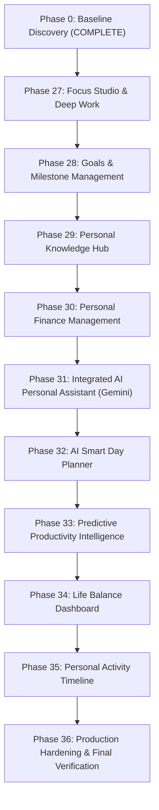

# MASTER IMPLEMENTATION BASELINE AUDIT & ARCHITECTURAL ROADMAP
## Personal Assistant PWA — Intelligent Personal Life & Work Operating System

**Date:** November 2026  
**Repository:** `D:\PT`  
**Baseline Build:** `@assistant/api` (NestJS 10) PASS | `@assistant/web` (Next.js 14) PASS | TypeScript 0 errors  
**Design System:** Lavender Enterprise SaaS (`#8B45F5`, `#EAE9FF`, `#F4F3FF`, `#202033`)  

---

## 1. BASELINE REPOSITORY AUDIT

### 1.1 Existing Architecture
- **Monorepo Structure:** `npm workspaces` containing `apps/api`, `apps/web`, and `packages/shared`.
- **Database:** Supabase PostgreSQL with 21 active Prisma models (`User`, `UserSettings`, `Task`, `Project`, `Routine`, `RoutineOccurrence`, `SchedulePlan`, `ScheduleChange`, `Reminder`, `ReminderAttempt`, `InAppNotification`, `PushSubscription`, `TaskEvent`, `WellnessMetric`, `WellnessCheckIn`, `WellnessDailySummary`, `DailySummary`, `AutomationRule`, `AutomationRuleExecution`, `UsageEvent`, `OutboxEvent`).
- **Cache & Queues:** Cloud Redis 7 and BullMQ 5.21.2 (`reminders`, `notifications` queues).
- **Core Security:** Cryptographic `SupabaseAuthGuard` (HS256) with Redis user identity cache, user-scoped queries (`where: { userId }`), and PostgreSQL Row-Level Security (RLS) on all 20 tables.

### 1.2 Missing Enterprise Modules Identified in Master Scope
1. **Focus Studio & Deep Work (Phase 27):** Pomodoro timer, Deep Work mode, distraction-free interface, task/project/goal linking, session persistence, and focus analytics.
2. **Goals & Milestone Management (Phase 28):** Multi-tier goal hierarchy (Daily, Weekly, Monthly, Quarterly, Yearly, Life), milestone tracking, progress rollups, and reviews.
3. **Personal Knowledge Hub (Phase 29):** Notes, daily journal, bookmarks, folders, tags, full-text search, and project linking.
4. **Personal Finance Management (Phase 30):** Accounts, categories, transactions (Prisma Decimal), budgets, savings goals, recurring subscriptions, cashflow analytics, and CSV export.
5. **Integrated AI Personal Assistant (Phase 31):** Google Gemini API integration (`@google/genai` / REST adapter), conversation history, schema-validated tool calling, confirmation workflows, and user isolation.
6. **AI Smart Day Planner (Phase 32):** Schedule proposal generator, time blocking, conflict detection, and transactional application.
7. **Predictive Productivity Intelligence (Phase 33):** Explainable trends, deadline risk analysis, workload balancing, and recommendation factors.
8. **Life Balance Dashboard (Phase 34):** Consolidated 8-dimension balance indicators, activity distribution, and reflections.
9. **Personal Activity Timeline (Phase 35):** Chronological unified cross-domain activity audit feed with deep links and filtering.
10. **Production Hardening (Phase 36):** E2E test suites, rate limiting, and final verification.

---

## 2. PHASE-BY-PHASE EXECUTION ROADMAP

---

## 3. RELATIONAL SCHEMA EXPANSION PLAN

The following models will be introduced into `prisma/schema.prisma` with appropriate relations, foreign key cascades, and composite indexes:

### Phase 27 (Focus)
- `FocusSession`: `id`, `userId`, `taskId?`, `projectId?`, `startedAt`, `endedAt`, `pausedDuration`, `plannedDuration`, `actualDuration`, `status` (`ACTIVE`, `PAUSED`, `COMPLETED`, `ABANDONED`), `interruptionCount`, `notes`.
- `FocusPreference`: `id`, `userId` (unique), `focusDurationMinutes` (default 25), `shortBreakMinutes` (5), `longBreakMinutes` (15), `longBreakInterval` (4), `dailyTargetMinutes` (120), `soundEnabled` (true).

### Phase 28 (Goals)
- `Goal`: `id`, `userId`, `parentId?`, `title`, `description`, `type` (`DAILY`, `WEEKLY`, `MONTHLY`, `QUARTERLY`, `YEARLY`, `LIFE`), `status` (`NOT_STARTED`, `IN_PROGRESS`, `COMPLETED`, `PAUSED`, `ARCHIVED`), `priority` (`LOW`, `MEDIUM`, `HIGH`), `progressPercent` (Float), `startDate`, `targetDate`, `completedAt`.
- `GoalMilestone`: `id`, `goalId`, `userId`, `title`, `order`, `isCompleted`, `completedAt`, `dueDate`.
- `GoalProgressLog`: `id`, `goalId`, `userId`, `previousProgress`, `newProgress`, `notes`, `recordedAt`.

### Phase 29 (Knowledge)
- `KnowledgeFolder`: `id`, `userId`, `name`, `color`, `icon`, `parentId?`.
- `KnowledgeNote`: `id`, `userId`, `folderId?`, `title`, `content` (Markdown/rich-text), `category` (`NOTE`, `JOURNAL`, `IDEA`, `LEARNING`), `isBookmarked`, `isArchived`, `pinned`.
- `KnowledgeTag`: `id`, `userId`, `name`.
- `KnowledgeTagOnNote`: `noteId`, `tagId`.
- `Bookmark`: `id`, `userId`, `url`, `title`, `description`, `faviconUrl`, `category`.

### Phase 30 (Finance)
- `FinanceAccount`: `id`, `userId`, `name`, `type` (`CHECKING`, `SAVINGS`, `CREDIT`, `INVESTMENT`, `CASH`), `currency` (`USD`, `EUR`, `GBP`, `INR`, etc.), `balance` (`Decimal(14, 2)`).
- `FinanceCategory`: `id`, `userId`, `name`, `type` (`INCOME`, `EXPENSE`), `icon`, `color`.
- `FinanceTransaction`: `id`, `userId`, `accountId`, `categoryId?`, `type` (`INCOME`, `EXPENSE`, `TRANSFER`), `amount` (`Decimal(14, 2)`), `currency`, `date`, `description`, `notes`, `paymentMethod`.
- `FinanceBudget`: `id`, `userId`, `categoryId`, `month` (`YYYY-MM`), `allocatedAmount` (`Decimal(14, 2)`).
- `SavingsGoal`: `id`, `userId`, `name`, `targetAmount` (`Decimal(14, 2)`), `currentAmount` (`Decimal(14, 2)`), `targetDate`, `status`.
- `RecurringTransaction`: `id`, `userId`, `accountId`, `categoryId?`, `title`, `amount` (`Decimal(14, 2)`), `frequency` (`MONTHLY`, `WEEKLY`, `YEARLY`), `nextDate`, `isSubscription`, `isActive`.

### Phase 31 & 32 (AI Assistant & Smart Planner)
- `AIConversation`: `id`, `userId`, `title`, `createdAt`, `updatedAt`.
- `AIMessage`: `id`, `conversationId`, `userId`, `role` (`USER`, `ASSISTANT`, `SYSTEM`), `content`, `toolCalls` (Json?), `toolResults` (Json?).
- `AIAction`: `id`, `userId`, `actionType`, `description`, `payload` (Json), `status` (`PROPOSED`, `CONFIRMED`, `EXECUTED`, `REJECTED`), `idempotencyKey`, `executedAt`.
- `PlanningProposal`: `id`, `userId`, `date`, `status` (`DRAFT`, `APPROVED`, `APPLIED`, `REJECTED`), `explanation`, `originalSchedule` (Json), `proposedSchedule` (Json), `diffMetrics` (Json).

---

## 4. UI ARCHITECTURE INTEGRATION STRATEGY

1. **Command Center Preservation:** The Command Center dashboard layout will not be altered. The compact, single-screen responsive grid (`ModernDribbbleDashboard.tsx`) remains intact.
2. **Horizontal Navbar Enhancement:** The central navigation bar (`HorizontalNavbar.tsx`) and mobile bottom nav will be cleanly extended with navigation tabs for the new workspaces:
   - `Focus` (`/focus` or Tab `focus`)
   - `Goals` (`/goals` or Tab `goals`)
   - `Knowledge` (`/knowledge` or Tab `knowledge`)
   - `Finance` (`/finance` or Tab `finance`)
   - `AI Assistant` (Drawer / Tab `ai-assistant`)
   - `Smart Planner` (Tab `planner`)
   - `Life Balance` (Tab `life-balance`)
   - `Activity Timeline` (Tab `timeline`)
3. **Lavender Enterprise Design Language:** All new components will strictly adhere to the approved tokens:
   - Primary: `#8B45F5`, Dark: `#6935C8`
   - Backgrounds: `#EAE9FF`, `#F4F3FF`, Card: `#FFFFFF`
   - Borders: `#E5E2F5`, Text: `#202033`, Subtitle: `#74738A`
   - High-contrast, polished typography and micro-interactions.

