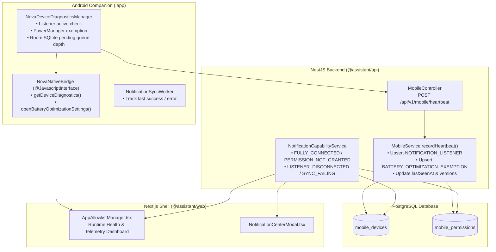

# 62-02 — Runtime Health Architecture

**Execution Date:** 2026-11-17  
**Branch:** `feature/unified-android-apk`  

---

## 1. Subsystem Architecture

The Runtime Health & Telemetry subsystem bridges the physical Android device, the authenticated NestJS backend, and the Next.js Web Shell into a unified diagnostic state machine.

---

## 2. Capability State Classifications
- `FULLY_CONNECTED`: Device paired, notification listener granted and active within past 2 hours, recent events synchronized.
- `PERMISSION_NOT_GRANTED`: Paired device has not enabled system Notification Access.
- `LISTENER_DISCONNECTED`: Permission granted but native daemon inactive or process asleep.
- `SYNC_FAILING`: Permission granted but synchronization delayed for over 48 hours.
- `NO_DEVICE_PAIRED`: No active companion device associated with user tenant.
