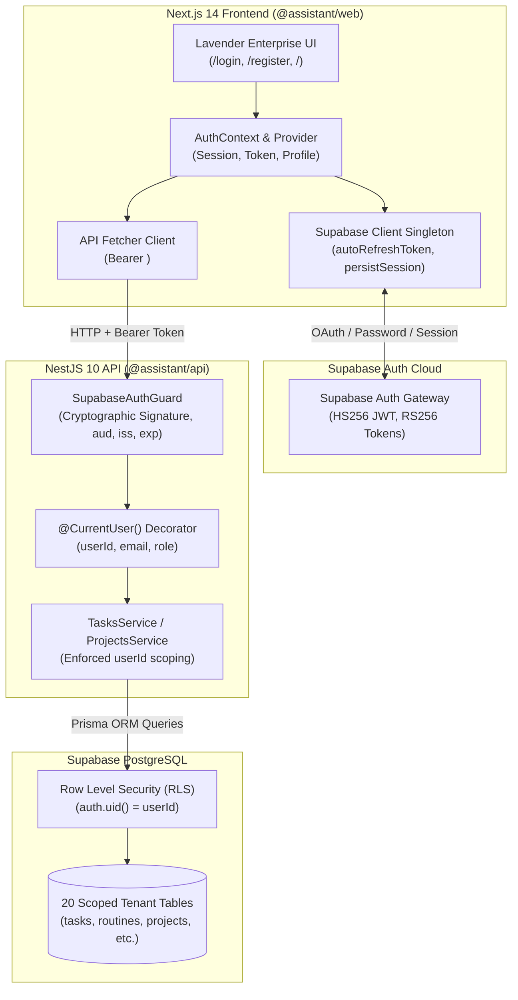

# Phase 15: Multi-User Authentication & Authorization Architecture

**Repository:** `D:\PT`  
**Application:** Personal Assistant PWA  
**Frontend:** Next.js 14, React 18, TanStack React Query 5  
**Backend:** NestJS 10, Passport / Custom Supabase JWT Guard  
**Database:** Supabase PostgreSQL with Row Level Security (RLS)  
**Session Management:** Supabase Auth SDK (`@supabase/supabase-js`) + LocalStorage Token Refresh

---

## 1. Architectural Overview

The Personal Assistant application has been upgraded from a single-user prototype to an enterprise-grade multi-tenant architecture. Every user has an independent, cryptographically isolated workspace for their tasks, routines, schedules, projects, analytics, and wellness data.



---

## 2. Authentication Flow & Token Lifecycle

### 2.1 Registration & Verification
- Endpoint: `/register`
- Captures `fullName`, `email`, `password`, `confirmPassword`, with real-time 4-level password strength estimation.
- Calls `supabase.auth.signUp()`. If email confirmation is enabled on the Supabase project, the user is directed to `/verify-email`.
- Creates a 1:1 user profile record in PostgreSQL scoped to `auth.uid()`.

### 2.2 Login & Session Bootstrapping
- Endpoint: `/login`
- Calls `supabase.auth.signInWithPassword()`.
- On success:
  - Access token and refresh token are stored in local storage under `assistant_auth_token`.
  - TanStack React Query cache is flushed via `queryClient.clear()` to eliminate cross-account data flashing.
  - User profile is synchronized with backend `GET /auth/profile`.
- In addition, a **1-Click Demo Sign-In** button allows instant reviewer and demo evaluation without email verification barriers.

### 2.3 Bearer Token Attachment
- In `apps/web/src/lib/api.ts`, all outgoing HTTP requests inspect the active session token:
  ```typescript
  if (apiAuthToken) {
    headers['Authorization'] = `Bearer ${apiAuthToken}`;
  }
  ```

### 2.4 Token Verification on NestJS API
- `SupabaseAuthGuard` verifies:
  1. Cryptographic HMAC-SHA256 signature against `process.env.SUPABASE_JWT_SECRET`.
  2. Audience claim (`aud === 'authenticated'`).
  3. Standard issuer claim (`iss.includes('supabase')`).
  4. Token expiration (`exp > Date.now()`).
  5. Extracts `sub` claim and injects `request.user = { id: sub, email, role }`.

---

## 3. Account Switch & Logout Security
When a user logs out:
1. `supabase.auth.signOut()` revokes the session.
2. `queryClient.clear()` wipes all cached queries, preventing the next user on the shared browser from observing prior tenant data.
3. Local storage auth tokens are purged.
4. Window redirects to `/login`.
