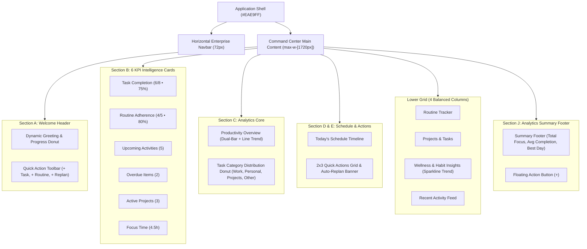

# Phase 19 — Command Center Design Specification
## Premium SaaS Productivity Control Center & Design System

---

## 1. Executive Summary & Design Vision

Phase 19 elevates the Personal Assistant Command Center into a tier-1 enterprise productivity dashboard inspired directly by the reference high-fidelity specification (`media_1793547552918_ab463c9f.jpg`).

The redesign eliminates all legacy placeholder concepts, marketing analytics terminology, and prototype styling. It provides immediate, actionable answers to the five core productivity questions:

1. **What have I completed today?** -> Task completion ring (6/8, 75%) and routine adherence ring (4/5, 80%).
2. **What do I need to complete next?** -> Upcoming activities KPI card and real-time today's schedule timeline.
3. **What requires my attention?** -> High-priority overdue items card with soft warning highlight and 1-click replan.
4. **How productive have I been?** -> Multi-day productivity overview (dual-bar completed vs scheduled + line completion trend) and total focus time tracking.
5. **How are my routines and projects progressing?** -> Dedicated 4-column balanced lower grid with routine check-in progress, active project milestones, wellness sparklines, and recent activity logs.

---

## 2. Design System Tokens

### 2.1 Color Palette
| Token Name | Hex Code | Visual Application |
| :--- | :--- | :--- |
| **Canvas Background** | `#EAE9FF` | Application shell background, calm enterprise lavender |
| **Card Background** | `#FFFFFF` | Primary content panels, elevation cards, modal surfaces |
| **Card Background Alt** | `#F8F7FF` | Interactive hover states, inset panels, muted badge fills |
| **Primary Accent** | `#8B45F5` | Primary CTA buttons, active tab indicators, chart primary series |
| **Primary Hover / Deep** | `#6935C8` | Pressed button states, dark pill tags, primary chart borders |
| **Secondary Accent** | `#3B82F6` | Secondary category bars (Personal), hydration metric icons |
| **Success / Done** | `#10B981` | Completed checkboxes, on-track status pills, routine badges |
| **Warning / Attention** | `#F59E0B` | Medium priority tags, project category donut segments |
| **Critical / Overdue** | `#E05268` | Overdue indicator cards, emergency replan buttons, missed habits |
| **Primary Text** | `#202033` | Primary headers, KPI values, high-contrast task titles |
| **Secondary Text** | `#74738A` | Subtitles, timestamps, chart axes, metadata labels |
| **Panel Border** | `#E5E2F5` | Clean 1px structural container and divider borders |
| **Subtle Divider** | `#F0F2FA` | Timeline separators, list row dividers, grid guides |

### 2.2 Typography Scale
- **Display Greeting:** 24px–28px, Font Weight 800 (Extrabold), tracking `-0.03em`.
- **Card Title / Heading:** 16px–18px, Font Weight 700 (Bold), tracking `-0.02em`.
- **KPI Value:** 28px–32px, Font Weight 900 (Black), tabular numbers.
- **Section Label / Eyebrow:** 11px–12px, Font Weight 600 (Semibold), uppercase or mixed-case.
- **Body / Metadata:** 12px–13px, Font Weight 500 (Medium), text color `#74738A`.

### 2.3 Elevation & Shadows
- **Cards & Panels:** `shadow-[0_4px_24px_rgba(139,69,245,0.035)]`
- **Floating Controls (FAB):** `shadow-[0_8px_30px_rgba(139,69,245,0.4)]`
- **Interactive Badges / Hover:** `shadow-[0_2px_12px_rgba(139,69,245,0.08)]`
- **Border Radius:** `rounded-[26px]` for major dashboard panels, `rounded-2xl` for child cards, `rounded-xl` for interactive pills and buttons.

---

## 3. Structural Layout & Component Breakdown

---

## 4. Component Details & Interactions

### 4.1 Section A — Welcome Header & Command Actions
- **Greeting Display:** Detects client hour to render `Good morning`, `Good afternoon`, or `Good evening` alongside the user's first name (e.g., `Good evening, Selma!`) and a friendly emoji.
- **Progress Donut Ring:** SVG circular progress ring displaying today's task completion percentage (`75%`) with `6/8 tasks completed`.
- **Status Indicator:** Green pill tag `• On Track` indicating healthy schedule pacing.
- **Action Toolbar:** 
  - `+ New Task`: Opens modal to create a task with time estimation and priority.
  - `+ Reminder`: Opens rapid reminder trigger modal.
  - `+ Routine`: Opens routine builder with recurrence rule selectors.
  - `+ Project`: Opens project modal with milestone tracking.
  - `Emergency Replan`: Coral button launching the deterministic replanning engine.

### 4.2 Section B — 6 Interactive KPI Cards
Arranged as a responsive grid (`grid-cols-2 md:grid-cols-3 lg:grid-cols-6`):
1. **Task Completion:** Current count `6/8`, mini circular percentage gauge `75%`, positive comparison `↑ 12% vs last week`. Clicking routes to Tasks workspace.
2. **Routine Adherence:** Count `4/5`, percentage gauge `80%`, trend `↑ 8% vs last week`. Clicking routes to Routines workspace.
3. **Upcoming Activities:** Count `5`, next scheduled event preview `10:00 AM - Team Meeting`. Clicking routes to Calendar.
4. **Overdue Items:** Count `2`, soft coral theme, breakdown `• 1 task • 1 reminder`. Clicking prompts instant reschedule or task detail drawer.
5. **Active Projects:** Count `3`, status `2 in progress • 1 on track`. Clicking routes to Projects workspace.
6. **Focus Time:** `4.5h`, hours completed in `WORK` category, trend `↑ 28% vs last week`.

### 4.3 Section C — Productivity Overview & Task Distribution
- **Combined Dual-Bar & Line Chart:**
  - Range filter dropdown: `Last 7 days`, `Last 30 days`, `Last 90 days`.
  - Dual vertical bar pillars per day: Completed tasks (solid purple `#8B45F5`) and scheduled tasks (translucent lavender `#D6CBFA`).
  - Interactive hover state: Floating tooltip displaying exact completed/scheduled counts, completion percentage, and formatted date.
  - Completion Rate Trendline: Connected green trend dots with cubic-bezier smoothed paths.
- **Task Distribution Donut Chart:**
  - SVG donut ring with 4 segmented arcs: Work (`42%`), Personal (`28%`), Projects (`18%`), Other (`12%`).
  - Center label displaying total task count `39 Total Tasks`.
  - Synchronized legend pills displaying segment color dots, category names, percentages, and item counts.

### 4.4 Section D & E — Today's Schedule & Quick Actions
- **Today's Schedule Timeline:**
  - Date header with calendar shortcut `View Calendar >`.
  - Chronological time slots (`08:00`, `10:00`, `12:30`, `14:00`, `16:00`, `19:00`).
  - Category badges with emoji icons (`💼 Work`, `🥪 Personal`, `📁 Project: Website Redesign`, `💚 Health`).
  - Interactive completion checkboxes triggering instant optimistic state updates and database synchronization.
- **Quick Actions (2x3 Grid):**
  - Six clean square cards with distinct pastel icon circles: Add Task, Add Reminder, Add Routine, Add Project, Add Event, Emergency Replan.
  - Emergency Replan callout banner with 1-click automatic schedule adjustment.

### 4.5 Lower 4-Column Grid
- **Card F: Routine Tracker:** Daily habit progress bars with percentage indicators, time badges, and status pills (`Done`, `4/5 cups`, `Missed`, `Upcoming`).
- **Card G: Projects & Tasks:** Tabbed switcher (`Active Projects` vs `Recent Tasks`), progress bars, task ratios (e.g., `6/8 tasks`), and completion percentages.
- **Card H: Wellness & Habit Insights:** 2x2 grid tracking Exercise (`4/5 days • 80%`), Water Intake (`6/8 cups • 75%`), Sleep (`7h 15m • Good`), and Mood (`Good`), plus a SVG 7-day wellness consistency sparkline (`78%`).
- **Card I: Recent Activity Feed:** Real-time chronological audit trail of completed tasks, routine check-ins, reminders, and system notifications.

### 4.6 Section J — Productivity Analytics Summary Footer & FAB
- **Summary Footer Bar:** Full-width rounded card displaying period tabs (`Weekly`, `Monthly`, `Custom`), Total Focus Time (`32h 45m ↑ 18%`), Avg Completion Rate (`78% ↑ 12%`), Most Productive Day (`Tuesday`), and Active Days (`6/7`).
- **Floating Action Button (FAB):** Persistent bottom-right floating purple button with an expandable speed-dial menu for mobile and desktop quick entry.

---

## 5. Responsive Behavior Matrix

| Viewport | Device Class | Layout Adaptation |
| :--- | :--- | :--- |
| **1920x1080** | Large Desktop | Full 6-column KPI row, 2-column analytics core (65%/35%), 2-column schedule/actions (55%/45%), 4-column lower widgets. |
| **1600x900** | Standard Desktop | Preserves desktop multi-column balance with scaled gutters (20px) and padded container bounds. |
| **1440x900** | Compact Desktop | Optimal proportioning, auto-wrapping header action toolbar. |
| **1366x768** | Standard Laptop | Compact padding, preserved 6-card KPI row with condensed typography. |
| **768x1024** | Tablet Portrait | 3-column KPI row (2x3 grid), stacked analytics cards, 2x2 lower widget grid. |
| **390x844** | Mobile Portrait | 2-column KPI grid, stacked full-width cards, scrollable schedule, sticky bottom nav bar, zero horizontal overflow. |

