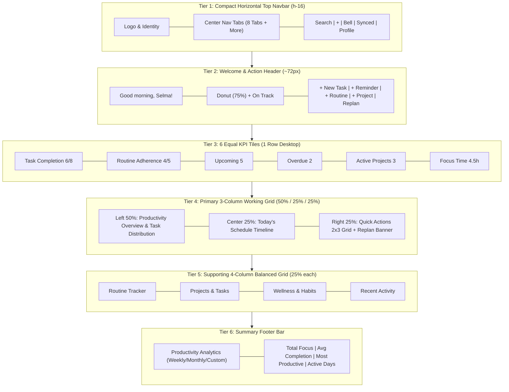

# Phase 20: Reference-Based Grid, Component Sizing & Visual Structure Specification

**Repository:** `D:\PT`  
**Product:** Personal Assistant PWA  
**Design Reference:** Dribbble Marketer Lavender Dashboard Architecture (`media_1793557086830_8cf18ee9.jpg`)  
**Specification Level:** Exact Structural Grid, Dimensional Hierarchy, Component Proportions

---

## 1. Executive Summary & Design Hierarchy

Phase 20 resolves the visual hierarchy distortion of Phase 19 where cards were oversized and secondary widgets were pushed far below the viewport fold. The layout has been rebuilt to strictly mirror the visual proportions, grid allocations, and content composition of the reference design.

The dashboard layout consists of five primary visual tiers:
1. **Tier 1: Global Horizontal Navbar** (~60–64px fixed compact height)
2. **Tier 2: Welcome & Quick Action Header** (~72px compact horizontal bar)
3. **Tier 3: 6-Column KPI Intelligence Row** (~110px compact status tiles)
4. **Tier 4: Primary 3-Column Working Grid (50% / 25% / 25%)**
   - **Column 1 (Left ~50%):** Unified Productivity Overview dual-bar & line chart + Task Distribution donut chart
   - **Column 2 (Center ~25%):** Today's Schedule timeline with real-time status and priority badges
   - **Column 3 (Right ~25%):** Quick Actions 2x3 interactive grid + Emergency Replanning callout banner
5. **Tier 5: Supporting 4-Column Balanced Grid (25% each)**
   - **Card 1 (25%):** Routine Tracker with progress bars and status indicators
   - **Card 2 (25%):** Projects & Tasks with dual tabs and completion progress
   - **Card 3 (25%):** Wellness & Habit Insights with 2x2 metric matrix + trend sparkline
   - **Card 4 (25%):** Recent Activity audit feed with relative timestamps
6. **Tier 6: Full-Width Analytics Summary Footer** with period selector, key productivity stats, and FAB

---

## 2. Design Tokens & Visual Specs

| Element | Specification | Tailwind Equivalent |
| :--- | :--- | :--- |
| **Canvas Background** | `#EAE9FF` (Soft Lavender) | `bg-[#EAE9FF]` |
| **Card Surface** | `#FFFFFF` with `#E5E2F5` border | `bg-white border border-[#E5E2F5]` |
| **Card Border Radius** | `16px` | `rounded-2xl` |
| **Card Shadow** | `0 4px 20px rgba(139, 69, 245, 0.035)` | `shadow-[0_4px_20px_rgba(139,69,245,0.035)]` |
| **Card Inner Padding** | `16px` to `20px` | `p-4 sm:p-5` |
| **Grid Gutters** | `14px` to `16px` | `gap-3.5 sm:gap-4` |
| **Brand Primary Purple** | `#8B45F5` | `text-[#8B45F5] bg-[#8B45F5]` |
| **Primary Deep Purple** | `#6935C8` | `bg-[#6935C8]` |
| **Accent Emerald Green** | `#10B981` / `#16A36A` | `text-[#16A36A] stroke-[#10B981]` |
| **Warning / Emergency Red** | `#E05268` / `#FFEAEF` | `text-[#E05268] bg-[#FFEAEF]` |
| **Primary Text Color** | `#202033` / `#18181B` | `text-[#202033]` |
| **Secondary Muted Text**| `#74738A` / `#717182` | `text-[#74738A]` |

---

## 3. Structural Grid Architecture

---

## 4. Column Ratio Breakdown

### Tier 4 (Primary Working Grid)
- **Total Span:** 12 Tailwind grid columns (`lg:grid-cols-12`)
- **Left Column:** `lg:col-span-6` (50% horizontal width)
  - Left sub-section (`md:col-span-7`): Productivity Overview dual-bar chart with green continuous trend line.
  - Right sub-section (`md:col-span-5`): Task Distribution donut chart (Work 42%, Personal 28%, Projects 18%, Other 12%) with central total `39 Total Tasks`.
- **Center Column:** `lg:col-span-3` (25% horizontal width)
  - Today's Schedule timeline containing 6 categorized items with time labels, emoji tags, and priority chips.
- **Right Column:** `lg:col-span-3` (25% horizontal width)
  - 2x3 Quick Action buttons (Add Task, Add Reminder, Add Routine, Add Project, Add Event, Emergency Replan) + Emergency Replan callout banner.

### Tier 5 (Supporting Grid)
- **Total Span:** 4 equal columns (`lg:grid-cols-4`, 25% each)
  - Column 1: Routine Tracker with progress bars and adherence badges (Done, cups, Missed, Upcoming).
  - Column 2: Projects & Tasks with Active Projects / Recent Tasks tabs and progress bars.
  - Column 3: Wellness & Habit Insights with 2x2 metric matrix and SVG trend curve.
  - Column 4: Recent Activity chronological audit trail with relative timestamps.
