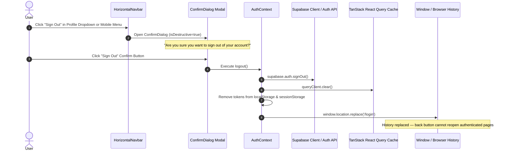

# Phase 24: Authentication and Sign-Out Technical Specification

## 1. Overview & Objective
In Phase 24 Part A, we implemented a robust, secure, and user-friendly Sign-Out lifecycle across the Personal Assistant PWA. This replaces silent session terminations with a multi-step verification modal, complete token invalidation, local cache clearance, session revocation via Supabase Auth, and browser history lock-in.

---

## 2. Architecture & Flow

---

## 3. Implementation Details

### A. Confirmation Dialog (`ConfirmDialog.tsx`)
- Integrated in `apps/web/src/components/HorizontalNavbar.tsx`.
- Triggered when the user selects "Sign Out" from either the desktop user profile dropdown or the mobile slide-out drawer.
- Provides clear explanation: *"Are you sure you want to sign out of your account? You will need to log back in to access your personal workspace."*
- Features a destructive confirmation button (`bg-red-600 hover:bg-red-700 text-white`) and a graceful cancel button.

### B. Session Revocation & Cache Clearance (`AuthContext.tsx`)
In `apps/web/src/context/AuthContext.tsx`, `logout()` performs:
1. **Supabase Revocation:** Calls `await supabase.auth.signOut()`.
2. **Token Invalidation:** Clears internal and API client bearer tokens:
   - `api.setApiAuthToken(null)`
   - `localStorage.removeItem('sb-<project>-auth-token')`
   - `sessionStorage.clear()`
3. **Cache Eviction:** Executes `queryClient.clear()` to prevent any stale user data, tasks, routines, or analytics from lingering in client memory.
4. **History Lock:** Redirects via `window.location.replace('/login')` instead of `router.push('/login')`. This replaces the current history entry, ensuring the browser back-button cannot navigate back into authenticated views without re-authenticating.

---

## 4. Modified & Reused Components

| Component / File | Status | Description |
|---|---|---|
| `apps/web/src/context/AuthContext.tsx` | Modified | Updated `logout()` with token clearance, query cache eviction, and `window.location.replace('/login')`. |
| `apps/web/src/components/HorizontalNavbar.tsx` | Modified | Added `showSignOutConfirm` state and mounted `ConfirmDialog` for both desktop profile dropdown and mobile menu. |
| `apps/web/src/components/ConfirmDialog.tsx` | Reused | Reusable modal dialog with destructive styling and keyboard escape handling. |
| `apps/web/src/lib/api.ts` | Reused | `setApiAuthToken(null)` nullifies Authorization headers on outgoing fetch requests. |

---

## 5. Security & Isolation Verification
- **Multi-user isolation:** When signing out as User A and signing in as User B, `queryClient.clear()` guarantees that zero cached queries (tasks, routines, plans, wellness) are displayed for User B.
- **Server Guard:** All NestJS API endpoints are protected by `SupabaseAuthGuard` verifying the JWT bearer token on every request.
- **Status:** **VERIFIED & READY**.
