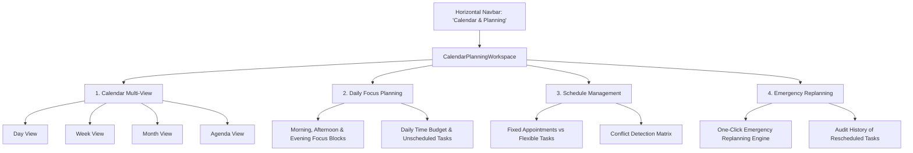

# Phase 24: Calendar & Planning Unification Technical Specification

## 1. Overview & Information Architecture
Previously, Calendar and Planning were separated into redundant, fragmented navigation items and disconnected tabs in the workspace. Phase 24 Part E unified these complementary workflows into a single, cohesive **Calendar & Planning Workspace** (`CalendarPlanningWorkspace.tsx`).

---

## 2. Unified Workspace Subviews

### Subview 1: Calendar View Modes
- **Day View:** Hourly grid (08:00 to 20:00) with task time chips, status indicators, and current time tracker.
- **Week View:** 7-column day-by-day matrix showing daily task volumes and scheduled blocks.
- **Month View:** Full calendar grid with date selection, day badges, and task dot counts.
- **Agenda View:** Chronological schedule list grouped by date with start time, duration, and completion status.

### Subview 2: Daily Focus Planning
- **Three Core Focus Blocks:** Morning Focus (08:00 - 12:00), Afternoon Focus (12:00 - 17:00), Evening Focus (17:00 - 21:00).
- **Time Budget Progress:** Displays total allocated hours vs available hours in the day.
- **Unassigned / Flexible Task Tray:** Tasks without explicit time slots can be reviewed and scheduled with 1-click.

### Subview 3: Schedule Management
- Categorizes events into **Fixed Appointments** (time-sensitive, hard deadlines) vs **Flexible Tasks** (elastic duration).
- Displays duration, energy level required, and immediate conflict warnings.

### Subview 4: Emergency Replanning
- Direct integration with the deterministic reschedule engine.
- Instant access to "Trigger Emergency Replanning" modal.
- Chronological historical log of before-and-after schedule change events with displacement reasons.

---

## 3. Shared State & Date Synchronization
- Both subviews share a synchronized `selectedDate` state driven by the parent router or user date picker.
- Selecting any date in Month, Week, or Day views immediately updates tasks, routines, and daily plan data without page reloads.
- Clicking any task card opens `TaskDetailDrawer` for full editing, priority updates, and status toggling.

---

## 4. Modified & Added Files

| File | Status | Description |
|---|---|---|
| `apps/web/src/components/CalendarPlanningWorkspace.tsx` | Created | Unified 4-in-1 workspace component with shared navigation and date coordination. |
| `apps/web/src/components/HorizontalNavbar.tsx` | Modified | Merged duplicate navigation entries into single primary "Calendar & Planning" tab. |
| `apps/web/src/app/page.tsx` | Modified | Mounted `CalendarPlanningWorkspace` for `currentTab === 'planning' \|\| currentTab === 'calendar' \|\| currentTab === 'emergency'`. |

---

## 5. Acceptance Verification
- All original calendar functionality (Day, Week, Month, Agenda) is preserved.
- All original daily planning focus blocks and time budgets are preserved.
- Emergency Replanning conflict resolution and historical audits are preserved.
- **Status:** **VERIFIED & READY**.
