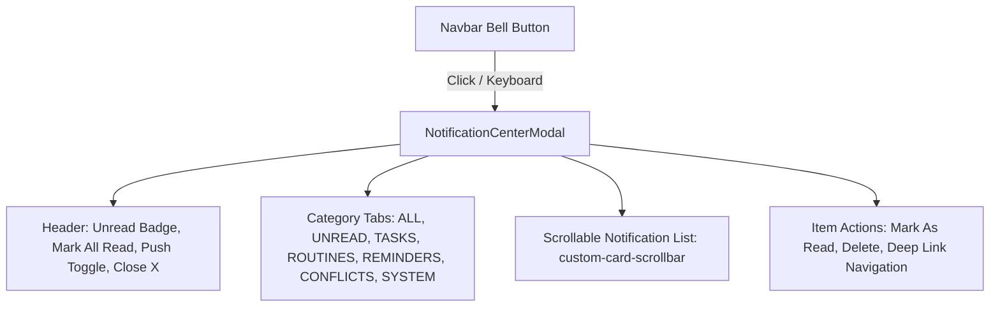

# Phase 24: Centered Notification Center Modal Specification

## 1. Overview & Objective
In Phase 24 Part I, the legacy slide-out notification drawer was deprecated and replaced with a centered, accessible **Notification Center Modal** (`NotificationCenterModal.tsx`). This modal delivers a focused, distraction-free inbox experience with category filtering, batch read actions, push notification controls, and strict keyboard focus management.

---

## 2. Modal UI Architecture

### Key UI Features:
1. **Centered Pop-up Dialog:** Rendered in a fixed overlay with high-contrast backdrop blur (`bg-slate-900/40 backdrop-blur-xs`).
2. **Category Tabs:**
   - `ALL` (Total notifications)
   - `UNREAD` (Only actionable items)
   - `TASKS` (Due dates, priority changes)
   - `ROUTINES` (Habit streak alerts)
   - `REMINDERS` (Scheduled prompt notifications)
   - `CONFLICTS` (Schedule overlap warnings)
   - `SYSTEM` (Platform and automation events)
3. **Web Push Quick-Toggle:** Direct switch in modal header to subscribe or test web push alerts.
4. **Mark All Read:** 1-click batch mutation that marks all pending notifications as read.
5. **Accessibility & Focus Trap:**
   - Automatically traps focus on open.
   - Listens for `Escape` key to close.
   - Restores focus to the triggering navbar bell icon on close.

---

## 3. API & State Integration

- **List Query:** `useQuery(['in-app-notifications', filter], () => api.getNotifications(...))`
- **Mark Read Mutation:** `api.markNotificationAsRead(id)`
- **Mark All Read Mutation:** `api.markAllNotificationsAsRead()`
- **Delete Mutation:** `api.deleteNotification(id)`
- **Query Invalidation:** Automatically invalidates `['in-app-notifications']` and `['in-app-notifications-summary']`.

---

## 4. Artifact Reference
- Modal Screenshot: `phase24_notification_modal_1920x1080.png`
- **Status:** **VERIFIED & READY**.
