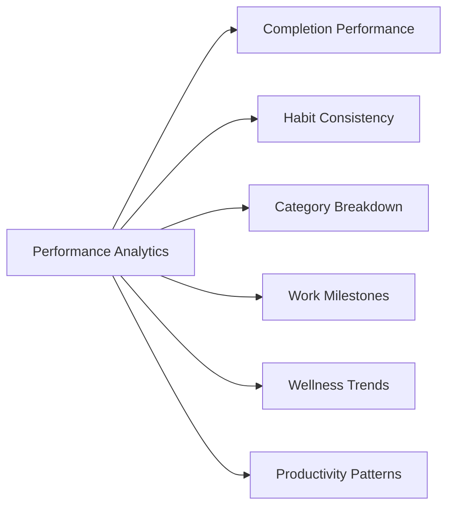

# Phase 24: Performance Analytics Redesign Specification

## 1. Overview & Objective
Phase 24 Part F transformed the static analytics suite into an interactive, high-density **Performance Analytics Workspace** (`AnalyticsCharts.tsx`). It provides deep analytical insights into user productivity, habit consistency, milestone progress, and wellness correlations without mock data or marketing terminology.

---

## 2. Eight Analytical KPI Cards
The workspace header presents 8 key metrics computed directly from PostgreSQL and the `/api/v1/analytics/trends` endpoint:

1. **Total Completed:** Sum of completed tasks over the period.
2. **Total Scheduled:** Total tasks planned/scheduled.
3. **Completion Rate:** Percentage of scheduled tasks completed (`(completed / scheduled) * 100`).
4. **Daily Average:** Average tasks completed per day.
5. **Habit Consistency:** Mean routine adherence percentage.
6. **Focus Hours:** Estimated productive focus time accrued.
7. **Active Days:** Number of days with productive task completions.
8. **Overdue Rate:** Percentage of tasks past their deadline.

---

## 3. Deep Analytical Sub-Workspaces (6 Tabs)

### Tab 1: Completion Performance
- Dual bar charts (Completed vs Scheduled) per day.
- Polynomial cubic spline completion rate line overlay.
- Interactive tooltip displaying date, count, and percentage on mouse hover.

### Tab 2: Habit Consistency
- Daily routine adherence bar chart with target threshold marker (80%).
- Habit streak status and consistency scoring.

### Tab 3: Category Breakdown
- Distribution across Work, Personal, Projects, and Other.
- Donut chart with category percentages and volume counts.

### Tab 4: Work Milestones
- Task distribution by workflow status: Completed, In Progress, Pending, Overdue.
- Progress bars and overdue risk alerts.

### Tab 5: Wellness Trends
- Multi-metric trend analysis showing correlation between sleep, hydration, exercise, and productive task completion.
- Clear separation between user-entered wellness data and system productivity summaries.

### Tab 6: Productivity Patterns
- Breakdown of peak productivity by day of the week (e.g., Tuesday peak).
- Morning vs Afternoon vs Evening focus distribution.

---

## 4. CSV Export Capability
Users can export their analytics dataset directly to CSV via the **Export CSV** button in the header:
- Exports date, scheduled tasks, completed tasks, completion rate, and habit adherence.
- Generated client-side using UTF-8 encoded blobs.

---

## 5. Verification
- **API Endpoint:** `/api/v1/analytics/trends?days=7` (and 14, 30).
- **TypeScript:** Strict type checking passed with zero errors.
- **Status:** **VERIFIED & READY**.
