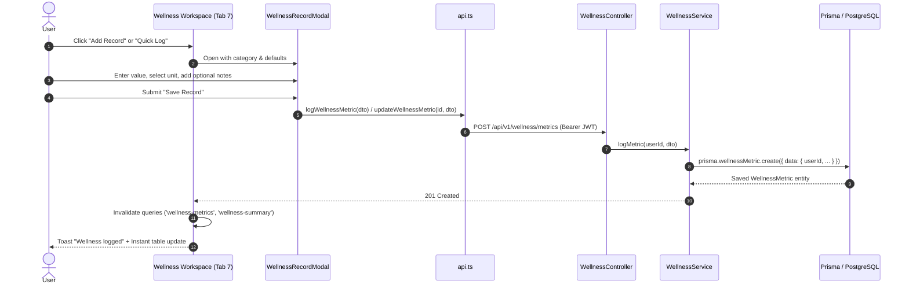

# Phase 24: Wellness Tracking & Interactive Add Record Specification

## 1. Overview & Objective
Phase 24 Part H replaced the static wellness display with a fully interactive **Health & Wellness Tracking Workspace** and modal (`WellnessRecordModal.tsx`). Users can log, edit, and delete real behavioral metrics with full persistence to PostgreSQL and strict user-scoped privacy isolation.

---

## 2. Supported Wellness Categories

| Category | Icon & Accent | Metrics Logged | Units Available | Target / Default |
|---|---|---|---|---|
| **Hydration** | `Droplet` (Blue) | Fluid volume intake | `ml`, `oz`, `glasses` | 2,000 ml / day |
| **Exercise** | `Footprints` (Emerald) | Workout duration, activity type, notes | `minutes`, `hours`, `steps` | 45 min / day |
| **Sleep** | `Moon` (Purple) | Rest duration, start & end time | `hours` | 8.0 hrs / night |
| **Focus Breaks** | `Coffee` (Amber) | Break duration, rest type | `minutes` | 15 min / break |
| **Mood & Energy** | `Smile` (Pink) | Energy score (1-10), mood descriptor, note | `score / 10` | Daily check-in |

---

## 3. Architecture & Data Flow

---

## 4. Record Management & Privacy Safety
- **Add / Edit / Delete Workflow:**
  - `POST /api/v1/wellness/metrics`: Creates a new metric entry.
  - `GET /api/v1/wellness/metrics?date=YYYY-MM-DD`: Returns today's logged records.
  - `PUT /api/v1/wellness/metrics/:id`: Updates an existing metric with user ownership verification.
  - `DELETE /api/v1/wellness/metrics/:id`: Deletes a metric after `ConfirmDialog` confirmation.
- **Privacy Notice:**
  - Wellness telemetry is strictly separated from general usage telemetry (Domain B).
  - Health data is never transmitted to analytics aggregators.
  - No medical conclusions or diagnostic statements are generated.

---

## 5. Artifact Reference
- Workspace Screenshot: `phase24_wellness_1920x1080.png`
- Modal Screenshot: `phase24_wellness_record_modal_1920x1080.png`
- **Status:** **VERIFIED & READY**.
