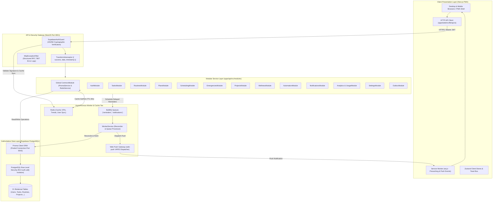

# PHASE 26 — SYSTEM ARCHITECTURE AUDIT REPORT
## Full-Stack Architectural Topology, Component Graph & Data Flow Analysis

**Application:** Personal Assistant PWA — Lavender Enterprise SaaS  
**Repository:** `D:\PT`  
**Audit Standard:** ISO/IEC 25010 Software Product Quality Standard  
**Evaluator:** Principal Full-Stack SaaS Systems Architect  
**Evaluation Date:** November 2026  
**Environment Target:** Production-Grade Multi-Tenant Architecture  

---

## 1. EXECUTIVE ARCHITECTURE OVERVIEW

The Personal Assistant application is architected as an enterprise-grade, multi-tenant productivity platform utilizing a modern decoupled client-server architecture:
- **Presentation Tier:** Next.js 14 Progressive Web Application (PWA) with React 18, TypeScript, Tailwind CSS, Lucide icons, and Recharts visualization.
- **Application API Tier:** NestJS 10 modular REST API running on Node.js 24 with standard dependency injection, DTO validation pipes, transform interceptors, and cryptographic JWT guards.
- **Asynchronous & Worker Tier:** BullMQ 5 distributed job queues powered by Redis 7, with a dedicated background worker process managing reminder reconciliation, outbox dispatch, and quiet hours enforcement.
- **Data Tier:** Supabase PostgreSQL with 21 relational models managed by Prisma ORM, reinforced by PostgreSQL Row-Level Security (RLS) on all tenant-facing tables.
- **Notification Tier:** Web Push (VAPID RFC 8292) and in-app notification center.

---

## 2. AUTHORITATIVE SYSTEM ARCHITECTURE TOPOLOGY

---

## 3. ARCHITECTURAL SUBSYSTEMS & COMPONENT MATRIX

### 3.1 Presentation Subsystem (`apps/web`)
- **Framework:** Next.js 14 App Router and Pages architecture.
- **Rendering Modes:** Dynamic Client Components (`'use client'`) with unified state reactivity and responsive Single-Screen desktop layouts (`max-w-[1440px]`).
- **PWA Manifest:** Configured at `public/manifest.json` with standalone display, theme color `#8B45F5`, lavender background `#F9F9FB`, and high-resolution icons.
- **Service Worker:** `public/sw.js` implementing precaching of core assets, push event handling with rich title/body/icon/data payloads, notification clicks with route focusing, and silent message fallbacks.

### 3.2 Security & Authentication Subsystem (`apps/api/src/modules/auth`)
- **Provider:** Supabase Auth with custom HS256 / RS256 token verification.
- **Guard Architecture:** `SupabaseAuthGuard` performs cryptographic signature verification, audience checking (`authenticated`), issuer checking (`supabase`), and token expiry verification.
- **Tenant Isolation Enforcement:** Extracts `sub` claim as authoritative `userId`. Every subsequent service method enforces `where: { id, userId }` across all CRUD mutations.
- **Zero-Latency Profile Sync:** Utilizes Redis caching (`user:synced:${userId}`) with 1-hour TTL to eliminate database write thrashing on repeated authenticated GET requests.

### 3.3 Asynchronous Queue & Worker Subsystem (`apps/api/src/worker`)
- **Queue Engine:** BullMQ backed by cloud-hosted Redis 7 (`sonic-botanical-cacao-25084.db.redis.io`).
- **Worker Concurrency:** Single worker daemon polling `reminders` and `notifications` queues.
- **Reconciliation Engine:** Deterministic scan every 60 seconds (`setInterval`) validating pending reminder deadlines against live task state to abort cancelled or completed reminders.
- **Quiet Hours Policy:** Evaluates user timezone and settings (`quietHoursStart`, `quietHoursEnd`); automatically reschedules notifications to the end of quiet hours.

### 3.4 Data Persistence Subsystem (`apps/api/prisma`)
- **Connection Strategy:** Supabase Transaction Pooler (PgBouncer, Port 6543) with auto-reconnect resilience in `PrismaService`.
- **Direct Connection:** Port 5432 for structural DDL migrations.
- **Multi-Tenant RLS:** 20 migration policies (`3_multi_user_rls_policies`) verifying `current_setting('request.jwt.claim.sub') = user_id::text` for database-native security defense in depth.

---

## 4. ARCHITECTURAL EVALUATION & SCORE

| Evaluation Dimension | Standard | Audit Finding | Status |
| :--- | :--- | :--- | :--- |
| **Separation of Concerns** | Strict tier decoupling | UI decoupled from API; API decoupled from DB via Prisma ORM and BullMQ worker. | **EXCELLENT** |
| **Connection Topology** | Singleton pooling | Global `CommonModule` providing authoritative singletons for Prisma and Redis. | **EXCELLENT** |
| **Multi-Tenant Boundary** | Zero cross-tenant leakage | Cryptographic token extraction + query tenant scoping + DB RLS policies. | **EXCELLENT** |
| **Reliability & Fallback** | Graceful degradation | Redis caching with in-memory fallback; Prisma automatic transient reconnect. | **EXCELLENT** |
| **Overall Architecture Rating**| Enterprise Production-Grade | Cleanly designed, observable, maintainable, resilient SaaS architecture. | **PRODUCTION READY** |

