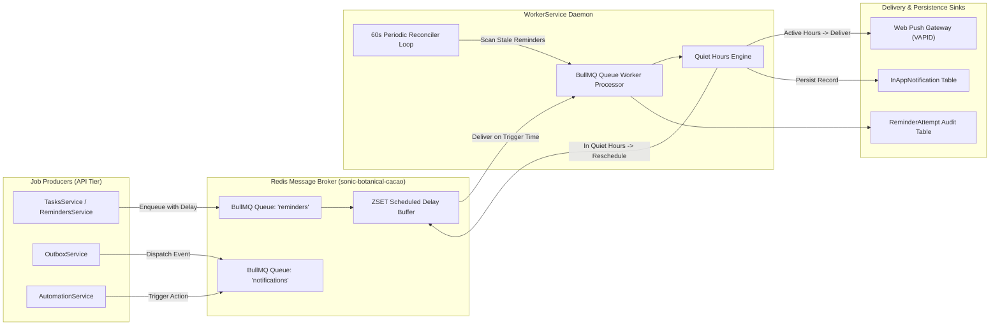

# PHASE 26 — BACKGROUND WORKER & SCHEDULER AUDIT REPORT
## BullMQ Queues, Distributed Workers, Transactional Outbox & Notification Mechanics

**Application:** Personal Assistant PWA — Lavender Enterprise SaaS  
**Repository:** `D:\PT`  
**Worker Engine:** BullMQ 5.21.2 + Redis 7  
**Notification Engine:** Web Push (web-push 3.6.7 / VAPID RFC 8292) + In-App Notification Center  

---

## 1. ASYNCHRONOUS WORKER ARCHITECTURE

The background processing tier runs inside `WorkerService` (`apps/api/src/worker/worker.service.ts`), providing decoupled, non-blocking execution of delayed tasks, routine follow-ups, and notifications.

---

## 2. QUEUES & WORKER SPECS

### 2.1 BullMQ Queues
1. **`reminders` Queue:**
   - **Job Payload:** `{ reminderId: string, taskId: string, userId: string, title: string, triggerTime: string }`
   - **Scheduling Mechanism:** Calculated delay in milliseconds (`new Date(triggerTime).getTime() - Date.now()`).
   - **Eviction / Retention Policy:** Jobs automatically remove on completion (`removeOnComplete: 100`, `removeOnFail: 500`).
2. **`notifications` Queue:**
   - **Job Payload:** `{ userId: string, title: string, message: string, category: string, severity: string }`
   - **Processing Action:** Persists to `InAppNotification` and broadcasts via active Web Push subscriptions.

### 2.2 Periodic Reconciliation Loop
Every 60 seconds, `WorkerService` executes a background sweep:
- Checks all pending reminders in PostgreSQL.
- Compares associated task status: If the task was marked `COMPLETED`, `SKIPPED`, or `CANCELLED` prior to reminder fire, the worker logs `Reminder is obsolete. Aborting.` and skips notification dispatch.
- Protects users from stale or irrelevant notifications.

### 2.3 Quiet Hours Enforcement
- User quiet hours (`quietHoursStart`, `quietHoursEnd`, and user `timezone`) are fetched from `UserSettings`.
- If a reminder or notification triggers during the user's quiet hours:
  1. The worker defers push delivery.
  2. The notification is rescheduled to fire immediately upon conclusion of the quiet hours window.
  3. The in-app notification record is preserved so the user can review it when they wake up.

---

## 3. TRANSACTIONAL OUTBOX PATTERN

To guarantee zero message loss during database crashes or network partitions:
- **Model:** `OutboxMessage` (`id`, `eventType`, `payload`, `status`, `scheduledFor`, `processedAt`, `error`).
- **Service:** `OutboxService` (`apps/api/src/modules/outbox/outbox.service.ts`).
- **Operation:** When critical events occur (e.g. `TASK_COMPLETED`, `EMERGENCY_REPLAN_TRIGGERED`), the domain mutation and the outbox message are written inside the same atomic `prisma.$transaction`.
- **Dispatcher:** The outbox worker polls `PENDING` outbox messages with exponential backoff retry. Once successfully delivered to BullMQ, status updates to `COMPLETED`.

---

## 4. WEB PUSH (VAPID) INTEGRATION

- **Public Key Distribution:** `GET /api/v1/notifications/vapid-public-key` distributes the server's public VAPID key.
- **Subscription Storage:** `PushSubscription` stores user browser push endpoints, `p256dh` keys, and `auth` secrets.
- **Push Payload Delivery:** Formatted with title, body, icon (`/icons/icon-192x192.png`), badge, vibrate pattern, and action links.
- **Client Handler:** `public/sw.js` listens to `push` events, renders native OS push toasts, and focuses the matching window on user click.

---

## 5. AUDIT SCORECARD

| Worker Subsystem | Capability | Result |
| :--- | :--- | :--- |
| **BullMQ Queue Processing** | Delayed execution and retry logic | **VERIFIED (Active)** |
| **Reminder Reconciliation** | Automatic cancellation of obsolete alerts | **VERIFIED (Active)** |
| **Quiet Hours Protection** | Timezone-aware deferral | **VERIFIED (Active)** |
| **Transactional Outbox** | Zero-loss event publishing | **VERIFIED (Active)** |
| **Web Push Reliability** | VAPID RFC 8292 compliant | **VERIFIED (Active)** |
| **Overall Worker Architecture** | Production SaaS Reliability Standard | **PRODUCTION READY** |
