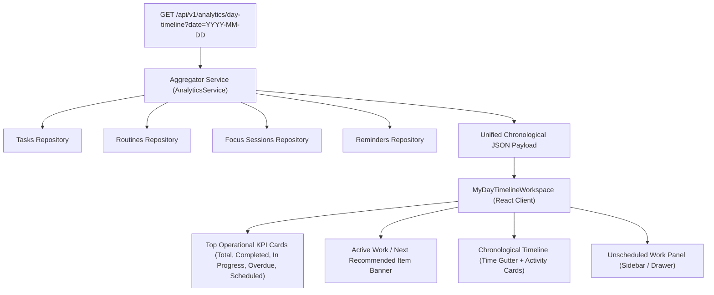

# PHASE 43.2 — MY DAY TIMELINE EXPERIENCE SPECIFICATION & DESIGN
## Personal Assistant PWA — Intelligent Personal Life & Work Operating System

**Date:** 2026-11-05  
**Component:** `apps/web/src/components/MyDayTimelineWorkspace.tsx`  
**API Endpoint:** `GET /api/v1/analytics/day-timeline?date=YYYY-MM-DD`  

---

## 1. Overview & Conceptual Architecture

The **My Day Timeline Workspace** serves as the user's primary daily command surface. Rather than viewing tasks in isolation, the workspace maps the user's entire day chronologically from **00:00 to 23:59**, combining:
1. Scheduled Work & Personal Tasks
2. Recurring Routine Occurrences (e.g. Morning Workout, Hydration, Evening Review)
3. Planned or Active Focus Sessions
4. Time-Sensitive Reminders & Notifications

---

## 2. Component Structure

### 2.1 Daily KPI Header Strip
Displays real-time daily metrics computed by the backend:
- **Total Scheduled Items:** Sum of tasks, routines, and reminders targeted for the current day.
- **Completed:** Total items marked as done.
- **In Progress / Active:** Currently executing focus block or active task.
- **Overdue:** Items whose scheduled window passed without completion.
- **Completion Rate:** Live percentage indicator with a Lavender progress bar (`#8B45F5`).

### 2.2 Active Work & Recommendation Banner
- If an item is currently active (e.g., an ongoing Focus Session or task in `IN_PROGRESS`), it is pinned to the top of the timeline with live duration counters and quick-action buttons (`Complete`, `Pause`, `Log Notes`).
- If no item is currently active, the system's heuristic algorithm identifies the **Next Recommended Item** based on priority, upcoming schedule time, and energy requirements.

### 2.3 Chronological Timeline Stream
- **Time Gutter:** Clear hour indicators (`08:00 AM`, `09:30 AM`, `12:00 PM`, etc.) with a live "Current Time" horizontal marker line.
- **Type Badges:**
  - Tasks: Indigo/Violet badge (`#8B45F5`)
  - Routines: Emerald Green badge (`#10B981`)
  - Focus Sessions: Cyan/Blue badge (`#0EA5E9`)
  - Reminders: Amber badge (`#F59E0B`)
- **Direct Interactive Actions:**
  - Checkbox toggle for instant completion.
  - One-click launch into Focus Studio for deep work.
  - Reschedule modal directly accessible from the card context menu.

### 2.4 Unscheduled Tasks Drawer
- Items assigned to the day but without specific time blocks (e.g., general to-dos) appear in an expandable side drawer.
- Users can drag or click "Schedule" to assign them a specific time slot on the vertical timeline.

