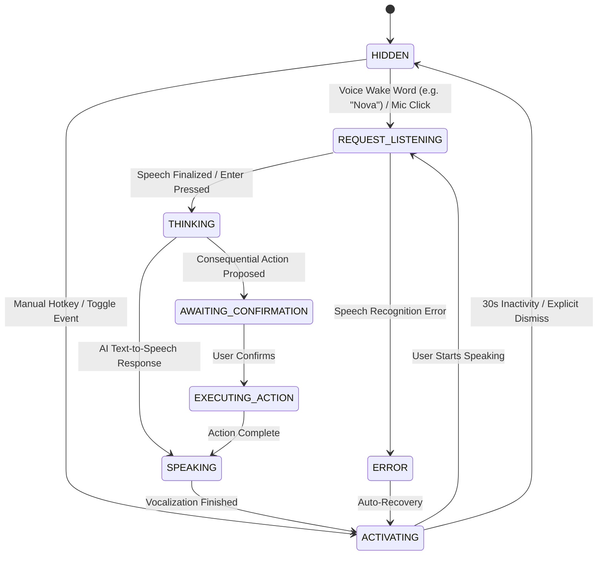

# PHASE 44 — AI ON-DEMAND INVOCATION SPECIFICATION & IMPLEMENTATION
## Personal Assistant PWA — Intelligent Personal Life & Work Operating System

**Date:** 2026-11-05  
**Component:** `apps/web/src/components/AIAssistant/AIAssistantExperience.tsx`  
**State Definitions:** `apps/web/src/components/AIAssistant/types.ts`  

---

## 1. Lifecycle State Machine Architecture

The AI Companion was redesigned to adhere to a strict finite-state machine (FSM):

### State Definitions
- `HIDDEN`: Zero DOM footprint. Neither 3D avatar stage, quick suggestions, nor command bar exist in the visual document flow.
- `WAKE_LISTENING`: Headless background speech listener listening exclusively for the configured assistant name.
- `ACTIVATING`: Transition state bringing the assistant into view with fade/slide animations.
- `REQUEST_LISTENING`: Microphone is active, capturing user speech query with real-time waveform.
- `THINKING`: Query submitted to Gemini AI backend; 3D avatar enters thinking rotation.
- `SPEAKING`: Text-to-speech audio stream active; 3D avatar lip-sync/volume pulsing.
- `AWAITING_CONFIRMATION`: High-risk action (task deletion, schedule overhaul) card presented for 1-click confirmation.
- `EXECUTING_ACTION`: Applying mutations to PostgreSQL backend.
- `ERROR`: Reversible error presentation with 2.5s recovery.
- `CLOSING`: Cleanup of Web Speech instances and timers before transition back to `HIDDEN`.

---

## 2. Voice Wake-Word Detection
- Listens continuously in the background using `webkitSpeechRecognition` / `SpeechRecognition` when enabled in settings.
- Matches against `settings.assistantName` (default: "Nova") as well as common conversational variations ("Hey Nova", "Ok Nova").
- When matched, dispatches immediate audible chime and transitions state to `REQUEST_LISTENING`.
- Safe exception handling: ignores browser speech recognition abort events without leaking errors.

---

## 3. Inactivity Dismissal & Safe Resource Teardown
- Automatic 30-second inactivity timer returns assistant to `HIDDEN` if the user stops interacting.
- Pressing "✕ Dismiss" or the ESC key cancels speech synthesis (`window.speechSynthesis.cancel()`), halts media streams, and hides the UI immediately.

