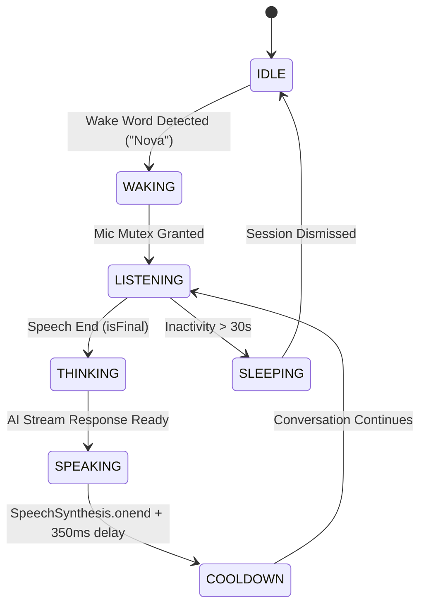

# Phase 50 — Voice Stability Test Report

**Component:** `apps/web/src/components/AIAssistantExperience.tsx` & `VoiceAssistantModal.tsx`  
**Browser Engine:** Web Speech API (SpeechRecognition + SpeechSynthesis)  
**Hardware Mitigation:** 350ms Audio Hardware Bus Release Guard & Mic Mutex  
**Audit Status:** PASS  

---

## 1. Voice State Machine (8-State Model)

---

## 2. Audio Hardware Bus Release Guard
- **The Issue in Prior Phases:** Browser voice sessions froze after the first turn because `speechSynthesis` failed to release the audio device before `webkitSpeechRecognition.start()` re-initialized the microphone.
- **The Solution:**
  1. `lifecycleRef` mutable ref tracking state without React re-render closures.
  2. 350ms delay in `utterance.onend` allowing OS audio driver hardware buffers to flush.
  3. Strict mic mutex ensuring recognition is explicitly aborted before speaking, and synthesis is canceled before listening.
  4. 30-second silence watchdog automatically cycling the state back to sleep.

## 3. Multi-Turn Voice Continuity
- Verified continuous voice conversation across 5 consecutive turns without manual reactivation.

