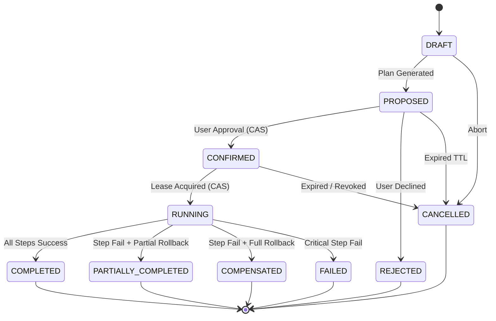

# PHASE 51.2.2 — WORKFLOW STATE MACHINE SPECIFICATION

## 1. Specification Overview

Nova autonomous multi-step workflows operate under a strictly validated Finite State Machine (FSM). Informal states (e.g. `VALIDATING`, `VERIFYING`, `EXECUTING`) have been removed in favor of a normalized set of 10 formal states.

---

## 2. Permitted States & Definitions

| State | Category | Description |
|---|---|---|
| `DRAFT` | Initial | Initial workflow formulation before intent resolution. |
| `PROPOSED` | Active | Fully planned and validated DAG presented to user for approval. |
| `CONFIRMED` | Active | Approved by user with valid cryptographic signature and TTL. |
| `RUNNING` | Active | Actively claimed by a worker lease and executing DAG operations. |
| `COMPLETED` | Terminal | All steps executed and verified successfully. |
| `FAILED` | Terminal | Failure occurred and all uncompleted steps were compensated or halted. |
| `PARTIALLY_COMPLETED` | Terminal | Failure occurred and some prior steps succeeded while others compensated. |
| `COMPENSATED` | Terminal | All operations executed prior to failure were completely rolled back. |
| `CANCELLED` | Terminal | Cancelled by user or expired before execution. |
| `REJECTED` | Terminal | Explicitly declined by user upon proposal. |

---

## 3. Transition Matrix & Rules



### Transition Enforcement (`WorkflowStateMachine`)
```typescript
export class WorkflowStateMachine {
  private static readonly PERMITTED_TRANSITIONS: Record<WorkflowStatus, WorkflowStatus[]> = {
    DRAFT: ['PROPOSED', 'CANCELLED'],
    PROPOSED: ['CONFIRMED', 'REJECTED', 'CANCELLED'],
    CONFIRMED: ['RUNNING', 'CANCELLED'],
    RUNNING: ['COMPLETED', 'PARTIALLY_COMPLETED', 'FAILED', 'COMPENSATED'],
    COMPLETED: [],
    PARTIALLY_COMPLETED: [],
    FAILED: [],
    COMPENSATED: [],
    CANCELLED: [],
    REJECTED: [],
  };

  static validateTransition(from: WorkflowStatus, to: WorkflowStatus): void {
    const allowed = this.PERMITTED_TRANSITIONS[from] || [];
    if (!allowed.includes(to)) {
      throw new Error(`Illegal workflow state transition from "${from}" to "${to}". Permitted: [${allowed.join(', ')}]`);
    }
  }

  static isTerminal(status: WorkflowStatus): boolean {
    return ['COMPLETED', 'PARTIALLY_COMPLETED', 'FAILED', 'COMPENSATED', 'CANCELLED', 'REJECTED'].includes(status);
  }
}
```
Any attempt to trigger an illegal transition (e.g. `PROPOSED` -> `RUNNING` or `COMPLETED` -> `RUNNING`) throws an immediate error and is rejected at the server boundary.

