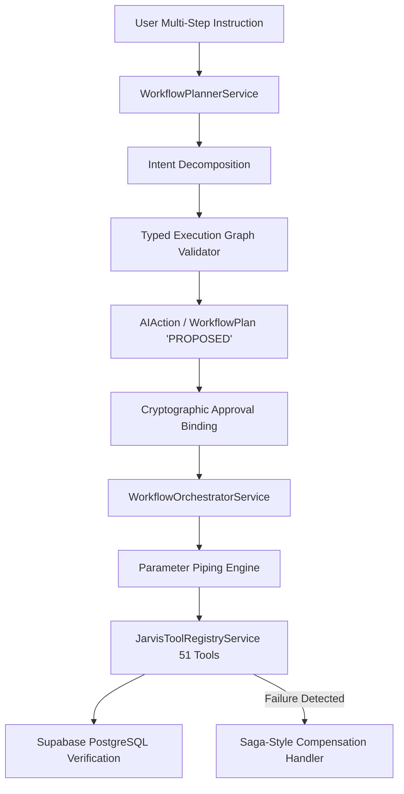

# Phase 51.2 — Multi-Step Workflow Architecture

## 1. System Context
Phase 51.2 transforms Nova from an atomic, single-tool execution assistant into a structured Multi-Step Autonomous Workflow Engine. Built strictly upon the Phase 51.1 unified tool registry, this architecture enables Nova to parse multi-intent instructions, build a typed Directed Acyclic Graph (DAG), validate dependencies, bind cryptographic approvals, orchestrate operations sequentially or concurrently with bounded concurrency, stream execution events, and perform saga compensation when failures occur.

## 2. Core Components

### 2.1 Intent Decomposition (`WorkflowPlannerService`)
- Maps natural language instructions into an ordered sequence of discrete operations.
- Identifies individual tool requirements (`create_project`, `create_task`, `start_focus_session`, `create_reminder`, etc.).
- Categorizes individual operations into risk tiers (`LOW`, `MEDIUM`, `HIGH`).
- Determines overall workflow risk: if any step is high risk, the entire workflow is categorized as high risk and mandates explicit confirmation.

### 2.2 Execution Graph Engine (`ExecutionGraphValidator`)
- Validates the DAG for:
  - Valid step identifiers.
  - Absence of self-dependencies.
  - Cycle detection using Depth-First Search (DFS).
  - Valid parameter piping syntax (`$stepId.field`).
  - Pre-requisite dependency declaration for piped ancestors.

### 2.3 Approval Binding
- Computes deterministic SHA-256 hash of all canonical step payloads:
  $$\text{Hash} = \text{SHA256}(\text{Canonical}(\text{Steps}))$$
- Approval binds `userId`, `workflowId`, and the exact payload hash.
- Any tampering or modification of parameters invalidates approval immediately.

### 2.4 Orchestration & Saga Compensation (`WorkflowOrchestratorService`)
- Dispatches operations via `JarvisToolRegistryService.executeTool(userId, toolId, input)`.
- Dynamically resolves piped outputs from upstream ancestor operations.
- Streams live progress (`STARTED`, `STEP_STARTED`, `STEP_COMPLETED`, `STEP_FAILED`, `STEP_COMPENSATED`, `COMPLETED`) via Server-Sent Events (SSE).
- In the event of an intermediate error, halts downstream operations and executes compensating actions in reverse order for reversible mutations (`delete_task`, `delete_project`, `delete_knowledge_note`).

