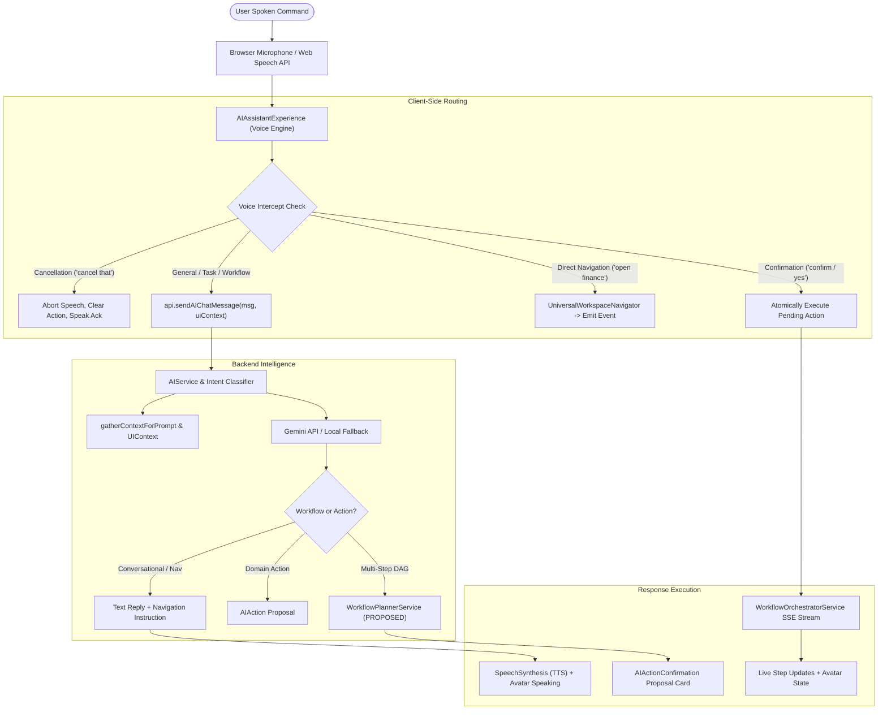

# PHASE 51.3 — UNIVERSAL VOICE ARCHITECTURE & SPECIFICATION

## 1. Executive Summary

Phase 51.3 unifies Nova's speech recognition, text-to-speech synthesis, workspace navigation, and multi-step autonomous workflow execution into a single, cohesive voice-first operating loop.

---

## 2. End-to-End Voice Architecture

---

## 3. Core Architectural Subsystems

1. **Voice Input & Microphone Lifecycle:** Continuous, single-session Web Speech API integration that operates exclusively while the application is active in the foreground. Automatically stops during TTS playback to avoid audio feedback loops.
2. **Context-Aware Intent Pipeline:** Both voice and text input travel through the exact same intent resolution route (`/api/v1/ai/chat` and `/api/v1/ai/workflows/plan`), sharing UI context (active tab, selected task, selected project).
3. **Client-Side Universal Navigation Service:** Resolves 22 distinct workspace tabs and natural language aliases without reloading the page.
4. **Multi-Step Workflow SSE Bridge:** Live SSE execution streaming directly to the assistant dock with per-step announcements and saga rollback visualization.
5. **Fail-Closed Safety & Vocal Confirmation:** Spoken confirmations ("confirm", "yes") require a valid pending action and check for unambiguous intent. Silence or ambient noise is never interpreted as approval.

