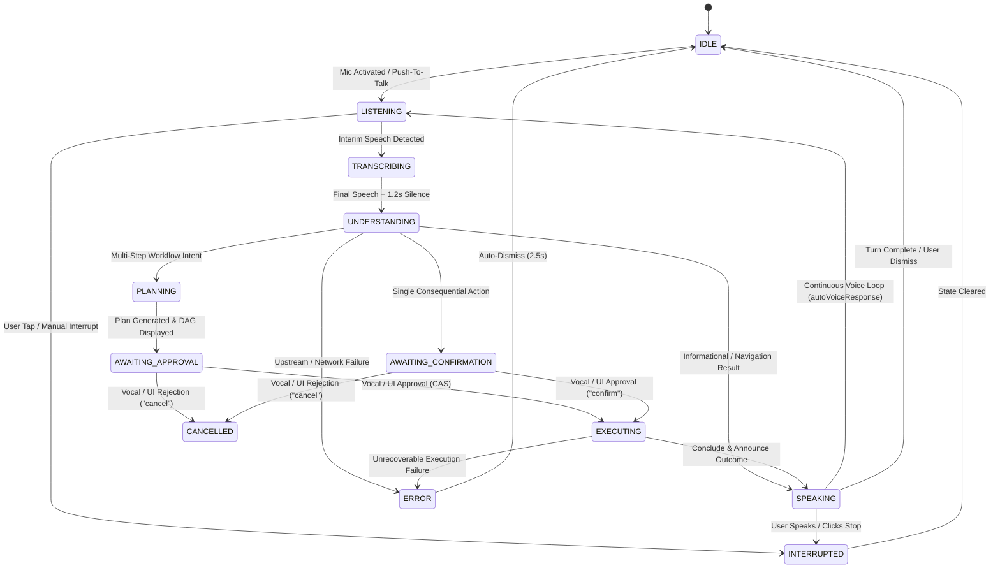

# PHASE 51.3 — VOICE STATE MACHINE SPECIFICATION

## 1. Specification Overview

Nova's voice interaction follows a deterministic Finite State Machine (FSM) spanning user speech input, transcription, intention classification, planning, confirmation, streaming execution, and speech feedback.

---

## 2. Formal Voice State Machine

---

## 3. State Definitions & Invariants

| State | Avatar Mapping | Microphone State | Audio Output | Invariants |
|---|---|---|---|---|
| `IDLE` | `idle` | Inactive | Inactive | Waiting for hotkey, dock click, or activation. |
| `LISTENING` | `listening` | Active | Inactive | Recording user audio; listening for interim tokens. |
| `TRANSCRIBING` | `listening` | Active | Inactive | Showing live text in transcript pill. |
| `UNDERSTANDING` | `thinking` | Inactive | Inactive | Resolving NLP intent and querying domain tools. |
| `PLANNING` | `planning` | Inactive | Inactive | Decomposing multi-step instructions into DAG. |
| `AWAITING_APPROVAL` | `awaiting_approval` | Inactive | Inactive | Plan displayed; waiting for explicit user approval. |
| `EXECUTING` | `executing` | Inactive | Inactive | SSE stream active; lease renewals in progress. |
| `SPEAKING` | `speaking` | Inactive | Active | TTS reading concise confirmation / response. |
| `INTERRUPTED` | `idle` | Inactive | Inactive | TTS cancelled immediately; pending actions cleared. |
| `CANCELLED` | `idle` | Inactive | Inactive | Proposal rejected; database action marked REJECTED. |
| `ERROR` | `error` | Inactive | Inactive | Toast displayed; fails closed. |

