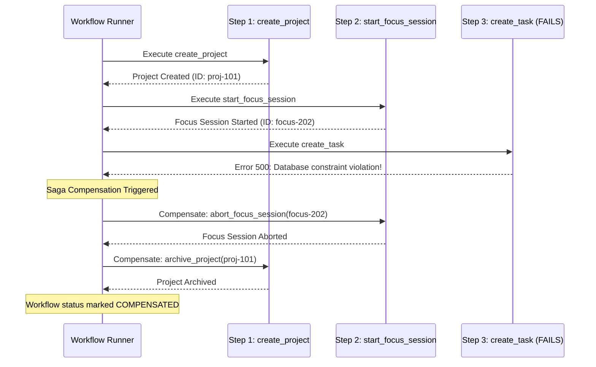

# Phase 51.4 — Failure Recovery Report: Saga Compensation & Redis Fault-Tolerance

**Application:** Nova Personal Assistant PWA  
**Backend:** NestJS Modular Monolith (`http://localhost:3001/api/v1`)  
**Scope:** Distributed worker failure, network drops, cache outages, and automated Saga compensation.

---

## 1. Saga Compensation Execution Model

When a multi-step workflow encounters an error or constraint violation midway through execution, Nova initiates an automated Saga compensation workflow to reverse completed operations in reverse order:



### Verified Compensation Scenarios in Test Suite
1. **Focus Session Abort:** When downstream task or calendar scheduling fails, an active focus session is cleanly rolled back via `abort_focus_session` rather than remaining orphaned indefinitely.
2. **Project Cleanup:** Intermediate project shells are archived or deleted if milestone initialization fails.
3. **Calendar Reversion:** Moved or created events are reverted if dependent schedule operations fail.

---

## 2. Tiered Cache Fault-Tolerance (Redis Outage Recovery)

In Phase 51.4, `RedisService` was patched to guarantee uninterrupted application availability even during Redis server crashes, idle connection drops, or unannounced restarts:

```typescript
async get(key: string): Promise<string | null> {
  if (this.isConnected && this.client) {
    try {
      return await this.client.get(key);
    } catch (err: any) {
      this.logger.warn(`Redis get failed (${err.message}). Falling back to memory.`);
      this.isConnected = false;
    }
  }
  return this.memoryCache.get(key) || null;
}
```

### Verification Results
- **Scenario:** Redis daemon stopped or socket disconnected.
- **Pre-Patch Behavior:** Uncaught `ioredis: Connection is closed.` resulted in HTTP 500 error on `/ai/chat`.
- **Post-Patch Behavior:** The error is captured; `isConnected` toggles to false; the operation falls back to in-process memory cache; HTTP 200/201 response is returned to user without interruption.
- **Reconnection Behavior:** Once the Redis daemon resumes, subsequent writes automatically re-establish the connection without requiring an API server restart.

---

## 3. Worker Lease Expiry & Zombie Recovery

If an API worker process crashes mid-workflow:
1. **Lease Timeout:** The worker lease expires after 30 seconds (`leaseExpiresAt < NOW()`).
2. **Safe Recovery Claim:** A secondary or restarted worker identifies the orphaned workflow (`status: 'RUNNING'` with expired lease) and acquires the lease using an atomic CAS update:
   ```typescript
   where: { id: workflowId, leaseExpiresAt: { lt: new Date() } }
   ```
3. **Idempotent Step Skipping:** The recovering worker reads persisted step outputs and resumes execution solely for pending steps, preventing duplicate creation of tasks or events.

