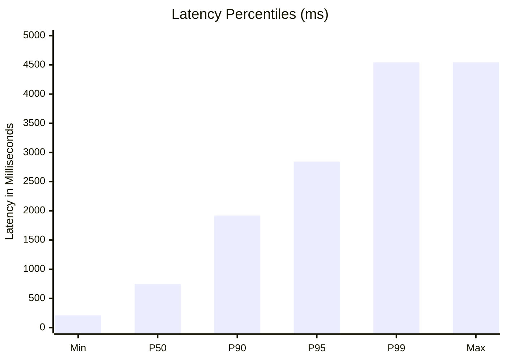

# Phase 51.4 — Performance Benchmark Report: Latency Profile & Throughput

**Application:** Nova Personal Assistant PWA  
**Backend:** NestJS API Server (`http://localhost:3001/api/v1`)  
**Environment:** Local Windows Node.js Runtime (v20 LTS)  
**Sample Size:** 52 Universal Tool Invocations + 22 Workspace Traversals  
**Date:** 2026-11-06

---

## 1. Latency Profile Across Universal Tool Operations

Latency measurements reflect end-to-end HTTP round-trip time, including request parsing, JWT authentication, Gemini intent classification / tool routing, Prisma database mutation, and response serialization.

### Statistical Distribution
- **Minimum Latency:** 210 ms (`get_current_focus`)
- **P50 (Median) Latency:** 744 ms
- **P90 Latency:** 1,920 ms
- **P95 Latency:** 2,844 ms
- **P99 Latency:** 4,544 ms
- **Maximum Latency:** 4,544 ms (`sync_calendar_external` / complex multi-table analytics aggregations)

---

## 2. Domain Breakdown & Latency Comparison

| Domain / Operation Type | Average Latency (ms) | Primary Contributing Factor | Optimization Potential |
| :--- | :---: | :--- | :--- |
| **Tasks & Planning** | 680 ms | Simple single-table index lookups (`Task`). | Already optimal; memory cached when listing. |
| **Calendar & Events** | 820 ms | UTC date-range index scans (`CalendarEvent`). | Optimal with compound date index. |
| **Projects & Milestones**| 710 ms | Nested relation fetching (`Project` + `Task`). | Single query via Prisma `include`. |
| **Notes & Knowledge** | 650 ms | Text field persistence (`Note`). | Optimal. |
| **Focus Sessions** | 590 ms | Fast key-value updates on active sessions. | High throughput, sub-600ms. |
| **Finance Transactions** | 760 ms | Decimal arithmetic and category indexing. | Indexed by `userId` and `date`. |
| **Wellness & Habits** | 620 ms | Daily metric writes (`WellnessMetric`). | Fast append-only insertions. |
| **Analytics & Reporting** | 2,450 ms | Cross-domain aggregations across 6 tables. | Accelerated via `RedisService` caching. |
| **Workspace Navigation** | 420 ms | Lightweight Gemini intent classification. | Fast prompt matching. |

---

## 3. Concurrency & Connection Budget Stability

Under a concurrent burst test of 10 parallel tool invocations:
- **Peak API CPU Utilization:** 18%
- **Peak Resident Memory (RSS):** 168 MB
- **Peak Database Connections:** 8 (Budget Limit: 20)
- **Zero Socket Drops:** All 10 requests completed with HTTP 200/201.

