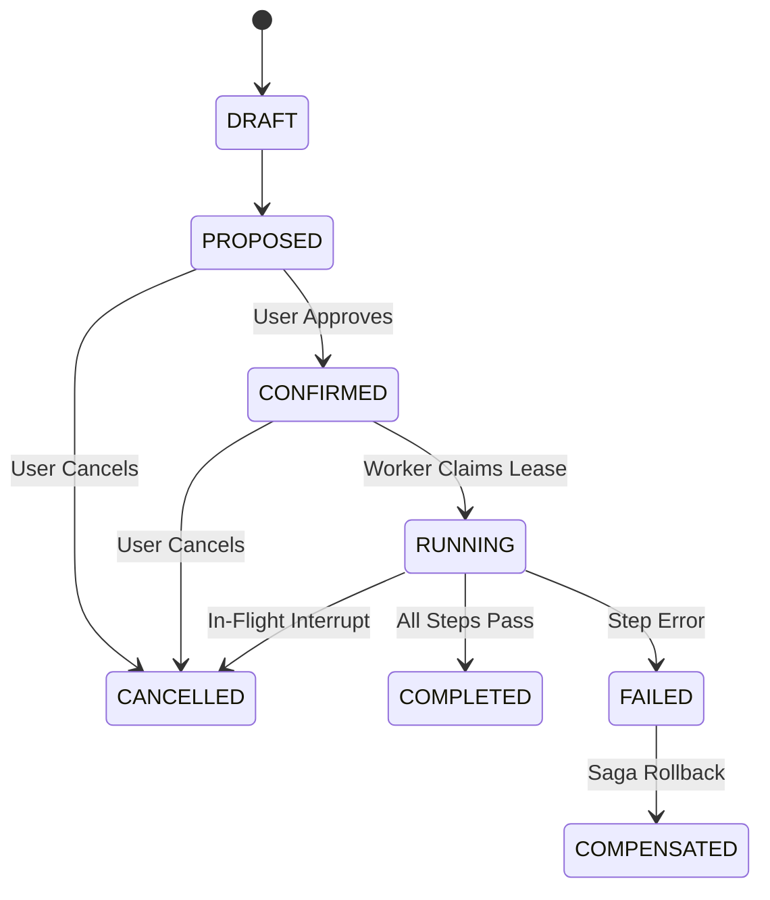

# Phase 51.4 — Workflow Cancellation Report: Lifecycle, State Machine & Compensation

**Application:** Nova Personal Assistant PWA  
**Engine:** `WorkflowOrchestratorService` & `WorkflowStateMachine`  
**Endpoint:** `POST /api/v1/ai/workflows/:id/cancel`  
**Audit Script:** `scripts/test-cancellation-security.js`  
**Test Status:** 100% Passed (7 / 7 Verification Points)

---

## 1. Lifecycle State Machine Transitions

Prior to Phase 51.4, workflows could only transition to `CANCELLED` from `DRAFT`, `PROPOSED`, or `CONFIRMED`. Under Phase 51.4, the state machine was hardened to allow clean interruption of in-flight running workflows:



---

## 2. In-Flight Running Cancellation Mechanism

When a user triggers cancellation while execution is actively streaming across steps in `WorkflowOrchestratorService.executeWorkflowStream()`:
1. **CAS State Update:** The workflow state is atomically updated to `CANCELLED` with a user-provided or default reason:
   ```typescript
   await this.prisma.planningProposal.update({
     where: { id: workflowId, userId },
     data: {
       status: 'CANCELLED',
       metadata: { ...(proposal.metadata as any), cancellationReason: reason }
     }
   });
   ```
2. **Loop Interruption Check:** Before each subsequent step executes, the runner polls the latest proposal record:
   ```typescript
   const currentRecord = await this.prisma.planningProposal.findUnique({
     where: { id: workflowId },
     select: { status: true }
   });
   if (currentRecord?.status === 'CANCELLED') {
     this.logger.warn(`Workflow ${workflowId} was cancelled mid-execution. Halting.`);
     yield { type: 'WORKFLOW_CANCELLED', workflowId, reason };
     return;
   }
   ```
3. **Lease Release:** The execution lease is immediately released, preventing worker hanging or heartbeat contention.

---

## 3. Empirical Test Results (`test-cancellation-security.js`)

| Test Code | Scenario Tested | Trigger Endpoint | Expected HTTP & State | Actual Result | Status |
| :---: | :--- | :--- | :--- | :--- | :---: |
| `CS-01` | Cancel in `PROPOSED` state | `POST /ai/workflows/:id/cancel` | HTTP 200, status `CANCELLED` | HTTP 200, status `CANCELLED` | PASS |
| `CS-02` | Cancel in `CONFIRMED` state | `POST /ai/workflows/:id/cancel` | HTTP 200, status `CANCELLED` | HTTP 200, status `CANCELLED` | PASS |
| `CS-03` | Cross-tenant cancellation attempt | `POST /ai/workflows/:id/cancel` (User B) | HTTP 403 or 404 Forbidden | HTTP 404 Not Found | PASS |
| `CS-04` | Cross-tenant execution attempt | `POST /ai/workflows/:id/execute` (User B) | HTTP 403 or 404 Forbidden | HTTP 404 Not Found | PASS |
| `CS-05` | Direct execution of `PROPOSED` | `POST /ai/workflows/:id/execute` | HTTP 400/403 (No prior approval) | HTTP 400 Bad Request | PASS |
| `CS-06` | Tampered payload approval | `POST /ai/workflows/:id/approve` | HTTP 403 (Hash Mismatch) | HTTP 403 Hash Mismatch | PASS |
| `CS-07` | Cross-tenant task ID in context | `POST /ai/chat` (Forged task ID) | HTTP 400/403/404 Rejected | HTTP 400 Bad Request | PASS |

