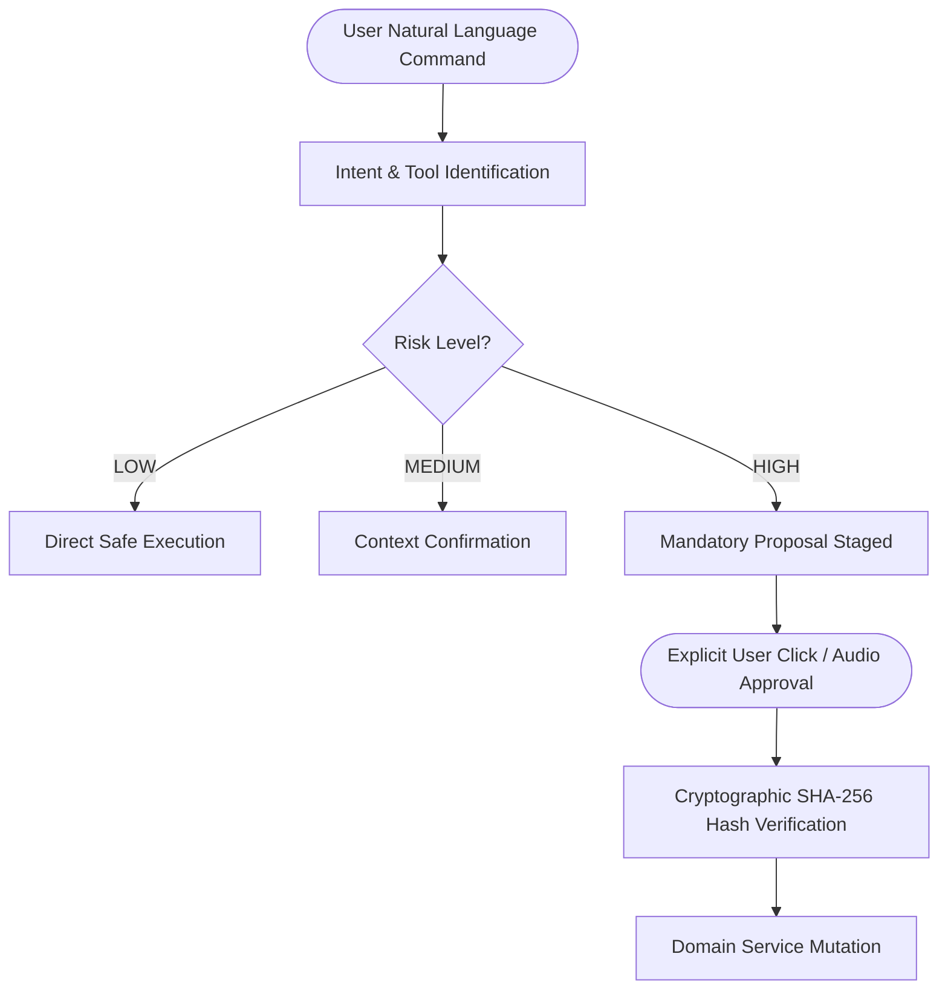

# Phase 51.5: Capability & Permission Transparency Report

**Application:** Nova Personal Assistant PWA  
**Service:** `JarvisToolRegistryService`  
**Total Domain Tools:** 52  
**Risk Distribution:** Low (38), Medium (9), High (5)

---

## 1. Risk Classification & Server-Side Approval Policies

To ensure complete transparency and user trust, every tool in Nova is classified into one of three risk tiers with enforced execution policies:

### High-Risk Tools Enforcing Server-Side Proposal Staging:
1. `delete_task`: Irreversible deletion of task records.
2. `delete_project`: Cascading archive/delete of project containers.
3. `delete_calendar_event`: Removal of scheduled appointments.
4. `delete_knowledge_note`: Deletion of second brain knowledge artifacts.
5. `delete_transaction`: Removal of financial transaction logs.

Direct execution of any HIGH risk tool without a pre-approved, un-tampered proposal token fails closed with `400 Bad Request` or `403 Forbidden`.

---

## 2. Capability Transparency in UI

Nova's UI explicitly surfaces:
- Whether a tool is read-only or mutates persistent database records.
- Which third-party integrations are actively connected (Gemini, Web Push) versus staging-simulated (Google Calendar).
- Real-time step execution progress via Server-Sent Events (SSE).
- Structured error and compensation messages without leaking internal database stack traces or credentials.

