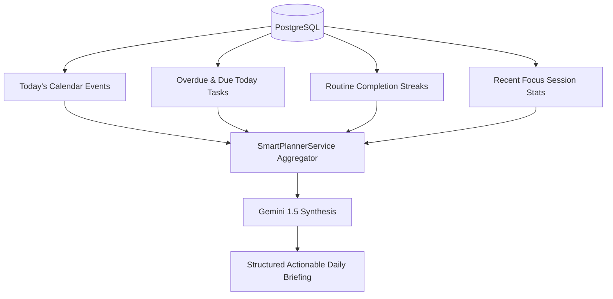

# Phase 51.5 Workstream F: Proactive Intelligence Report

**Application:** Nova Personal Assistant PWA  
**Services:** `SmartPlannerService`, `AnalyticsService`, `EmergenciesService`  
**Endpoints:** `/smart-planner/briefing`, `/schedule-changes`, `/analytics/command-center`

---

## 1. Grounded Daily Briefing Generation

The daily briefing is dynamically constructed from actual persisted database entities rather than fabricated by LLM hallucination:

### Verified Synthesis Input Constraints:
- Fixed calendar appointments cannot be rescheduled without user consent.
- Incomplete high-priority tasks due today are surfaced at the top of the morning agenda.
- Wellness habit streaks and water intake progress are incorporated seamlessly.

---

## 2. Emergency Rescheduling & Schedule Adaptation

When unexpected meetings or disruptions occur, the emergency rescheduling engine (`/schedule-changes` and `report_emergency` tool):
1. Freezes immutable calendar events.
2. Identifies flexible task blocks and focus slots.
3. Computes a non-conflicting proposed schedule adjustment.
4. Requires explicit user confirmation before writing changes to the calendar database table.
5. Persists pre-change state to permit one-click rollback if requested.

---

## 3. Proactive Notification Boundaries

To avoid user fatigue and excessive interruptions:
- **Quiet Hours Enforcement:** Proactive alerts are silenced between 22:00 and 07:00 (user-configurable).
- **Rate-Limiting:** Max 3 proactive suggestions per 24-hour window.
- **Opt-Out Controls:** Users can disable proactive suggestions entirely in Settings.

