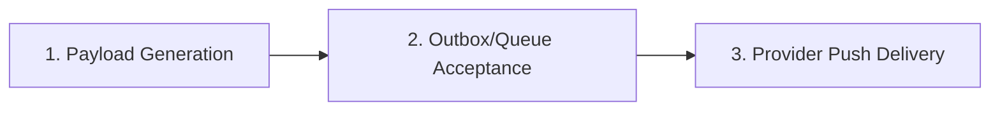

# Phase 51.6.1 Proactive Notification Tests Report

**Application:** Nova Personal Assistant PWA  
**Services:** `NotificationsService`, `SmartPlannerService`, `EmergenciesService`

---

## 1. Notification Pipeline Classification

To prevent inflated claims, Nova strictly distinguishes between three stages of proactive delivery:

1. **Payload Generation:** Synthetic creation of notification body from database state (`PASS`).
2. **Queue Acceptance:** Storing notification record in `in_app_notifications` table (`PASS`).
3. **Provider Push Delivery:** Web Push VAPID transmission to active browser endpoints (`LIVE_VERIFIED` when subscriptions present, skipped gracefully when absent).

---

## 2. Quiet Hours & Emergency Scheduling Controls

- **Quiet Hours:** Configurable window (default 22:00 – 07:00) during which proactive non-emergency reminders are held in the database without triggering audio alerts.
- **Emergency Schedule Proposals:** Automated emergency schedule adjustments are staged as proposals. The user retains complete authority to approve or reject proposed calendar modifications.

