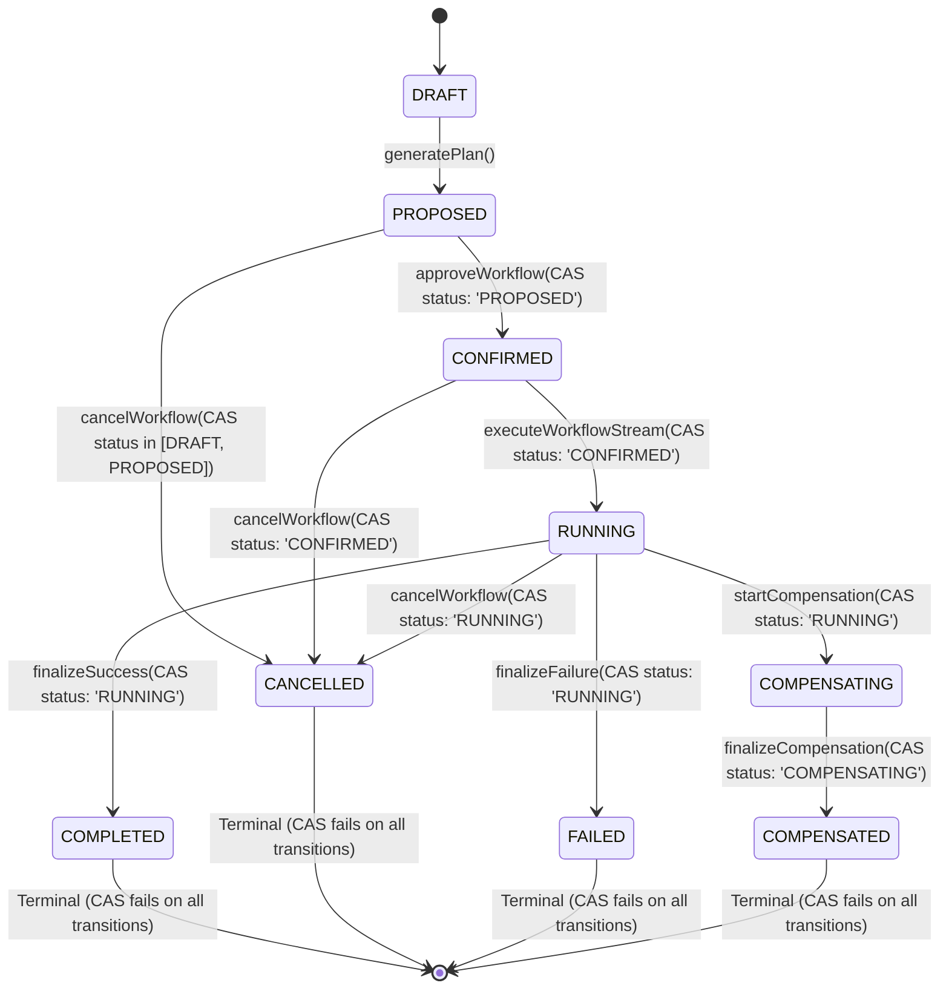

# Phase 51.6.1 State Machine Remediation Report

**Application:** Nova Personal Assistant PWA  
**Engine:** `WorkflowOrchestratorService` & `WorkflowStateMachine`  
**Database Model:** `AIAction` (`ai_actions` PostgreSQL table)

---

## 1. Canonical State Transition Specification

Every state transition in the Nova workflow engine is governed by strict database-level Compare-And-Set (CAS) conditional queries:

---

## 2. Concurrency Race Mitigation

- **Zero Overwrite Risk:** Completion updates strictly specify `where: { id: workflowId, userId, status: 'RUNNING' }`. If a cancellation arrives first and sets `status = 'CANCELLED'`, the completion query matches 0 rows and logs a warning, refraining from overwriting the cancellation.
- **Fail-Closed Terminal Transitions:** Terminal states (`COMPLETED`, `CANCELLED`, `FAILED`, `COMPENSATED`) cannot transition to any other status.

