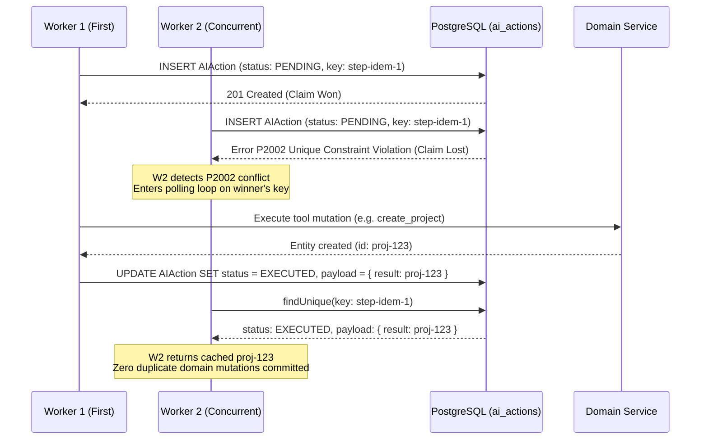

# Atomic Idempotency Architecture & Design

## 1. The Race Condition
When two distributed workers or rapid user clicks submit the same logical operation simultaneously:
```text
Worker 1: Query idempotency key -> null -> executeTool() -> create row -> save key
Worker 2: Query idempotency key -> null -> executeTool() -> create row -> save key
Result: 2 duplicate rows created in database.
```

## 2. The Atomic Claim Solution
To eliminate time-of-check to time-of-use (TOCTOU) races:


## 3. Database Failure & Rollback Guarantees
- **Fail-Closed on DB Disconnect:** If PostgreSQL is unreachable when an idempotency key is required, the mutation is immediately rejected with an error rather than silently executed without idempotency protection.
- **Atomic Failure Cleanup:** If the tool execution throws an error, the `PENDING` claim row is deleted immediately (`deleteMany({ where: { idempotencyKey, status: 'PENDING' } })`), ensuring subsequent retries or recoveries are not permanently blocked.
- **Tenant Isolation:** If an existing key belongs to another `userId`, the request is rejected with `403 Forbidden`.

