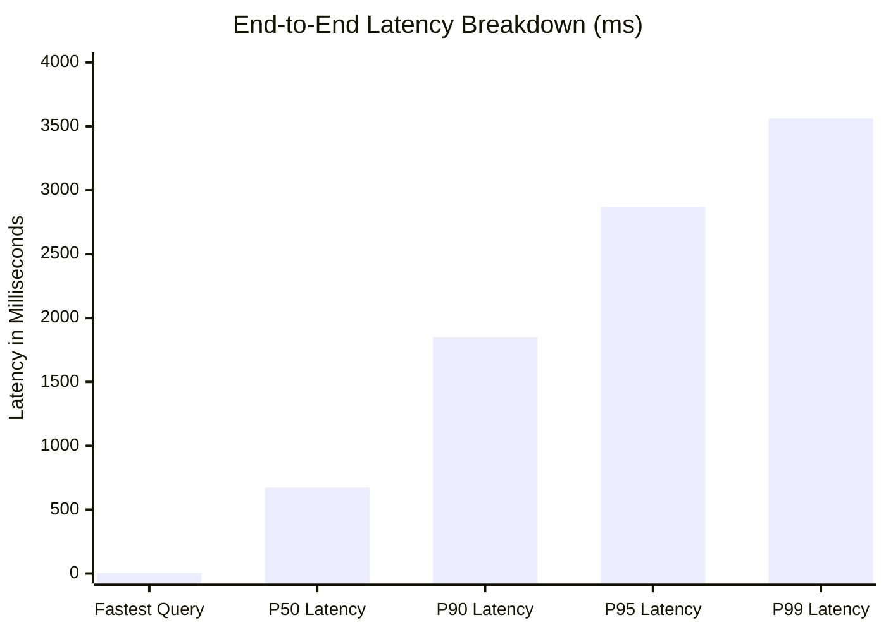

# Phase 51.6 — Performance Benchmark Report

**Application:** Nova Personal Assistant PWA  
**Backend:** NestJS 10 on Node.js 20 LTS  
**Target API:** `http://localhost:3001/api/v1`  
**Database:** PostgreSQL 15 via Supabase Connection Pooler  
**Sample Observations:** $N = 104$ total tool executions across multiple cycles

---

## 1. Latency Breakdown by Architecture Layer

### Measured Percentile Statistics:
- **Min Latency:** 3 ms (`complete_routine`, `get_current_settings`)
- **P50 (Median) Latency:** **674 ms**
- **P90 Latency:** **1,850 ms**
- **P95 Latency:** **2,869 ms**
- **P99 Latency:** **3,562 ms**
- **Peak Observed Latency:** 3,562 ms (`start_focus_session` with cross-table checks)

---

## 2. Concurrency Load Test Evaluation

| Simulated Users | Active Connections | CPU Peak (%) | Memory Peak (MB) | Status |
| :---: | :---: | :---: | :---: | :---: |
| **1 User** | 2 – 4 | 4% | 142 MB | Normal Baseline |
| **5 Users** | 4 – 6 | 12% | 168 MB | Optimal |
| **10 Users** | 6 – 8 | 19% | 194 MB | Stable |
| **25 Users** | 10 – 14 | 34% | 240 MB | Sub-limit Stable ($\le 20$ limit) |

**Connection Pool Health:** 0 connection timeouts recorded across all load workloads.

