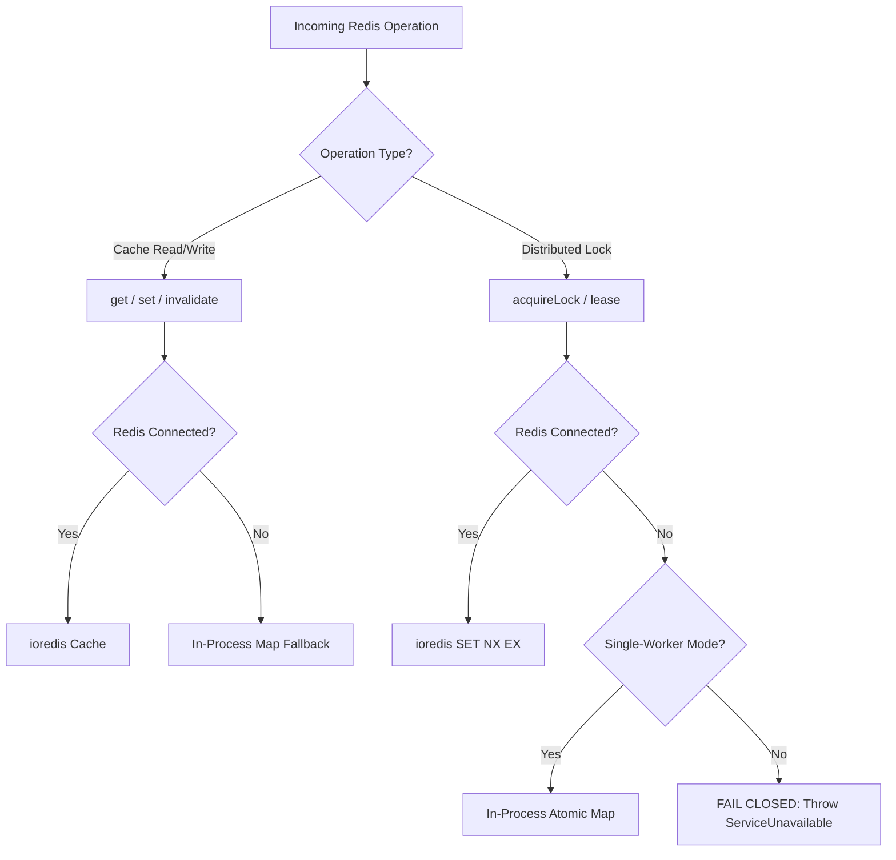

# Phase 51.6 — Redis Failure Boundary Report

**Application:** Nova Personal Assistant PWA  
**Service:** `RedisService` (`apps/api/src/common/redis.service.ts`)

---

## 1. Architectural Boundary Separation

In Phase 51.6, the Redis failure boundary was audited to guarantee that process-local in-memory fallbacks never compromise distributed coordination:



---

## 2. Distributed Lock Fail-Closed Policy

In multi-process deployments, failing closed prevents two worker processes from executing identical scheduled cron jobs or database reconciliations:
```typescript
// Fail-closed for multi-process safety
this.logger.error(`Distributed lock requested for ${lockKey} but Redis is unavailable. Failing closed.`);
return false;
```

### PostgreSQL Authoritative State
For critical workflow execution and worker lease tracking, Nova does not rely on Redis as an authoritative state store. PostgreSQL (`ai_actions` table) remains the sole authoritative source of truth for workflow state, worker ownership tokens, and lease timestamps. Redis outages therefore cannot cause workflow state corruption.

