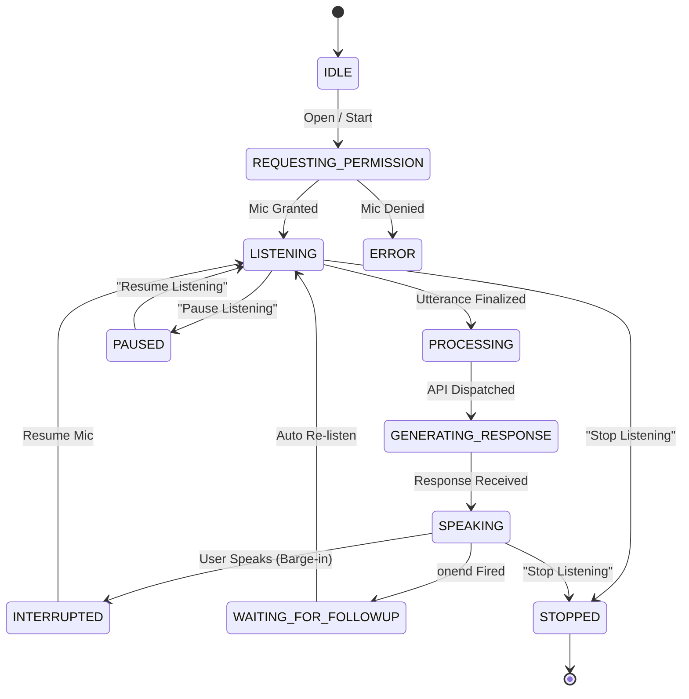

# PHASE 52.0: VOICE SESSION STATE MACHINE SPECIFICATION

## 1. Formal State Definitions

| State | Semantic Meaning | Active Audio Operation | Next Allowed States |
|---|---|---|---|
| `IDLE` | Modal closed or dormant | None | `REQUESTING_PERMISSION`, `LISTENING` |
| `REQUESTING_PERMISSION` | Prompting browser mic permission | `getUserMedia` | `LISTENING`, `ERROR` |
| `LISTENING` | Listening for user speech | `SpeechRecognition` + Analyser | `PROCESSING`, `PAUSED`, `STOPPED`, `ERROR` |
| `PROCESSING` | Submitting final transcript to API | None | `GENERATING_RESPONSE`, `ERROR` |
| `GENERATING_RESPONSE` | Waiting for backend AI response | None | `SPEAKING`, `ERROR` |
| `SPEAKING` | Speaking assistant response | `SpeechSynthesis` | `WAITING_FOR_FOLLOWUP`, `INTERRUPTED`, `STOPPED` |
| `WAITING_FOR_FOLLOWUP` | Brief transition window after speech | None | `LISTENING`, `STOPPED` |
| `INTERRUPTED` | Barge-in triggered mid-speech | Cancels Speech | `LISTENING`, `PROCESSING` |
| `RECOVERING` | Handling transient network drop | Backoff timer | `LISTENING`, `ERROR` |
| `PAUSED` | User explicitly paused voice | None | `LISTENING`, `STOPPED` |
| `STOPPED` | User ended session | None | `IDLE` |
| `ERROR` | Unrecoverable microphone failure | None | `IDLE`, `REQUESTING_PERMISSION` |

## 2. Transition Diagram

