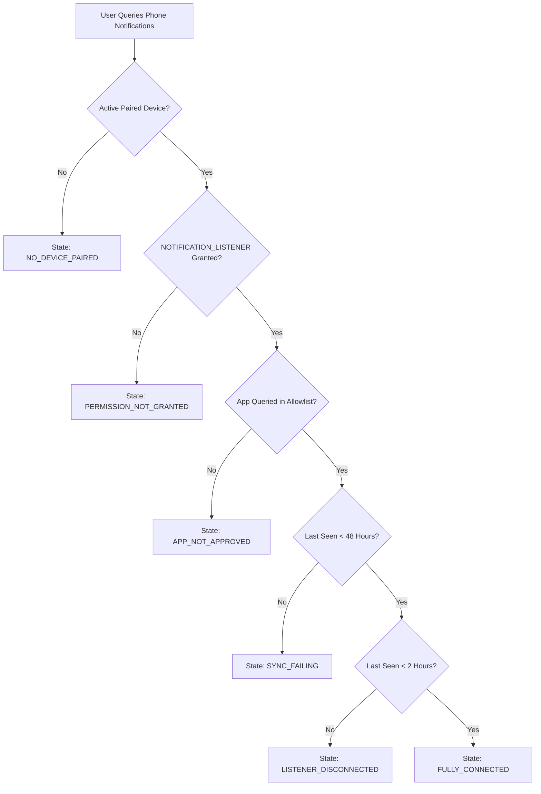

# 03 — ANDROID PERMISSION & CAPABILITY FLOW
## Android Notification Access & Lifecycle State Machine

**Author:** Principal Android Architect  
**Date:** November 2026  

---

## 1. Capability State Machine

NOVA computes the user's notification capability through a 5-state deterministic evaluation pipeline:

---

## 2. Conversational Directives by State

| State | Assistant Directive & Response Strategy |
| :--- | :--- |
| **`NO_DEVICE_PAIRED`** | Direct user to pair their Android smartphone in the Mobile Companion settings to enable phone notification reading. |
| **`PERMISSION_NOT_GRANTED`** | Inform user that Android Notification Access is not granted on their paired phone. Guide them to *Settings > Notification Access > NOVA JARVIS*. |
| **`APP_NOT_APPROVED`** | Explain that notifications for the requested app (e.g., Slack) are disabled in their Notification Preferences allowlist. |
| **`SYNC_FAILING`** | State that notification sync is delayed (>48h). Suggest opening NOVA app and checking phone battery optimization settings. |
| **`LISTENER_DISCONNECTED`** | Notify user that the listener is asleep. Ask them to launch NOVA Companion to re-awaken background sync. |
| **`FULLY_CONNECTED`** | Accurately summarize recent permitted notifications using actual `MobileEvent` database records. Never refuse for privacy reasons. |
