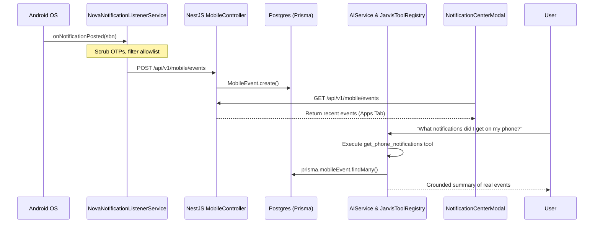

# 04 — NOTIFICATION EVENT ARCHITECTURE
## End-to-End Pipeline: Ingestion, In-App Storage & Assistant Surfacing

**Author:** Staff Software Engineer  
**Date:** November 2026  

---

## 1. Data Pipeline Overview

---

## 2. Ingestion Rules & Sanitization
1. **Allowlisted Applications**: Notifications are only processed if the source package is approved by the user.
2. **On-Device Sanitization**:
   - One-time verification codes, banking PINs, and credit card numbers are masked via regex before leaving the device.
3. **Deduplication**: SHA-256 payload hashing prevents redundant database insertions for ongoing notifications (e.g., media playback or download progress).
